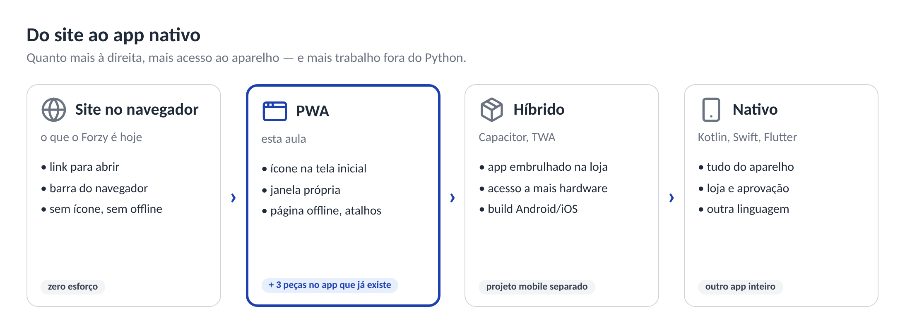
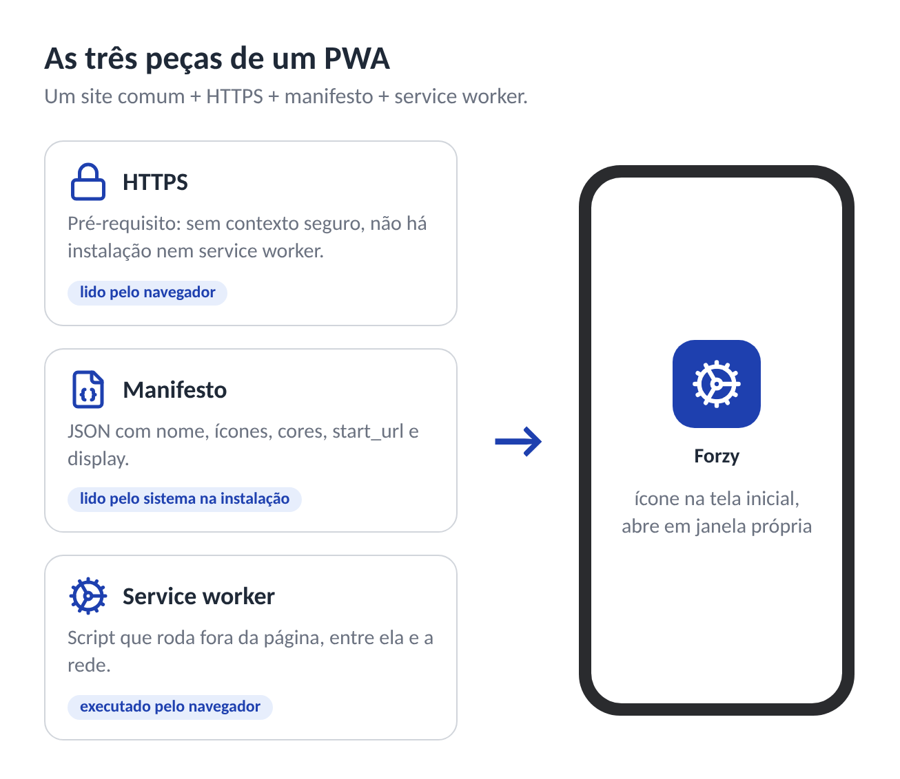
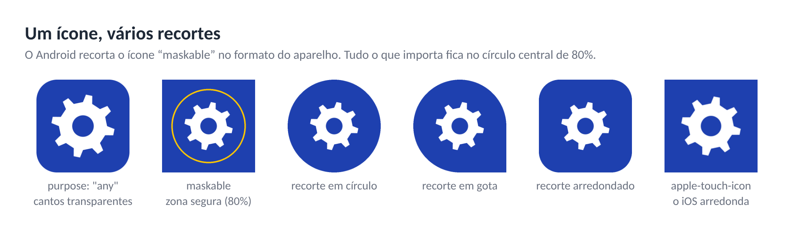
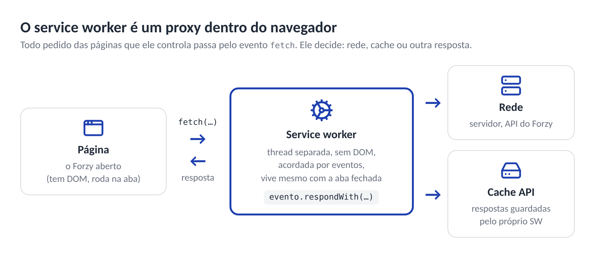
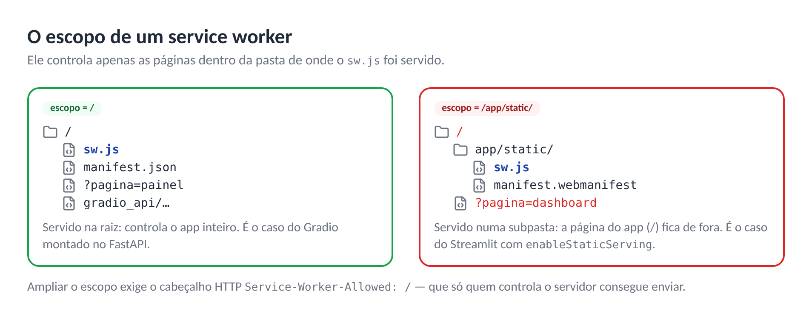
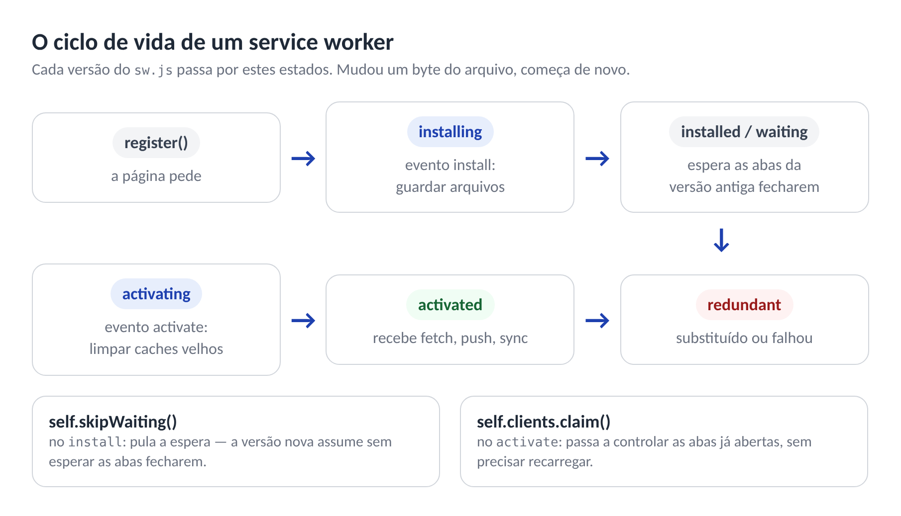
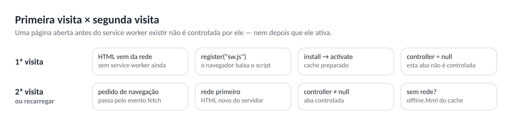
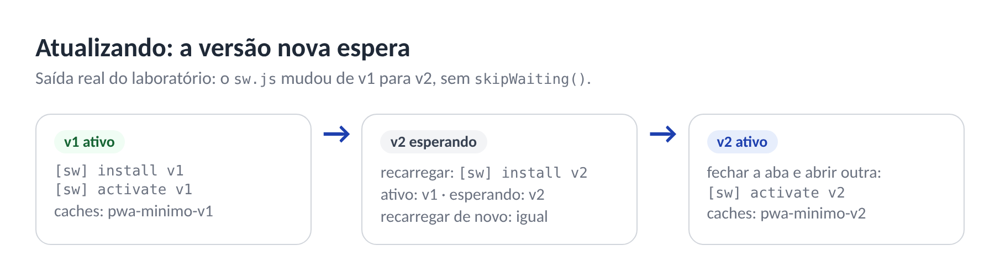
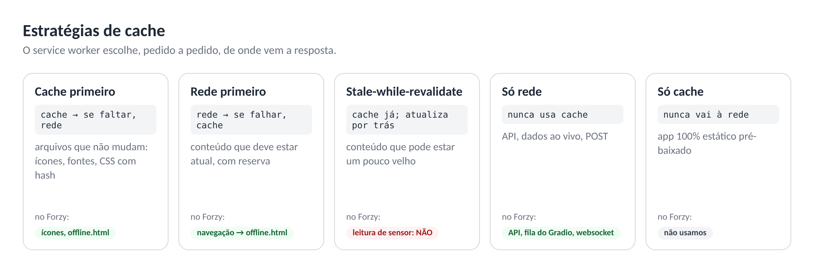
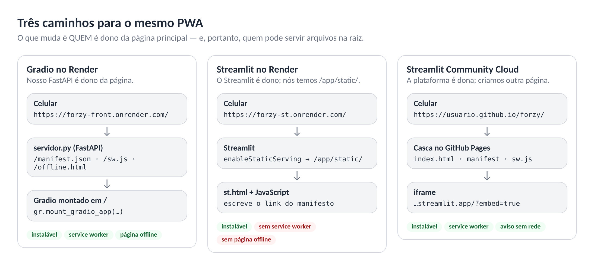

# Aula 22 — Mobile: PWA

---

# 1. O Problema: o App Mora no Navegador

Nas aulas de Design System Mobile o Forzy virou um app pensado para o celular: navegação na base da tela, alvos de toque de 48 px, o status do motor primeiro. Mas ele ainda **mora no navegador**. Para abrir o painel, o técnico de manutenção precisa:

1. abrir o Chrome;
2. achar a aba certa no meio de outras vinte, ou digitar o endereço;
3. dividir a tela com a barra de endereços e a barra de abas;
4. e, se a rede cair dentro da casa de máquinas, ver o dinossauro do Chrome.

As saídas tradicionais custam caro para quem trabalha em Python:

| Saída | Custo |
|---|---|
| App nativo (Kotlin no Android, Swift no iOS) | Duas linguagens novas, duas bases de código, duas lojas |
| Multiplataforma (Flutter, React Native) | Abandonar Python e reescrever a interface inteira |
| Publicar nas lojas | Conta de desenvolvedor, revisão, atualizações que dependem da aprovação da loja |

Entre "um site" e "um app nativo" existe um espectro:



| Degrau | O que é | Exemplo de uso |
|---|---|---|
| **Site** | Abre no navegador, dentro de uma aba | Documentação, blog |
| **PWA** | O mesmo site, com ícone na tela inicial, janela própria e resposta própria sem rede | Painéis, ferramentas internas, o Forzy |
| **Híbrido** (Capacitor, *Trusted Web Activity*) | Um site embrulhado num app nativo, publicado na loja | Quando a loja é obrigatória |
| **Nativo** | Código da plataforma | Acesso profundo a hardware, jogos, uso intenso em segundo plano |

O PWA é o degrau mais barato acima do site: o app que já existe ganha **alguns arquivos** e passa a ser instalável. Nada é reescrito.

---

# 2. O que é um PWA

**PWA (*Progressive Web App*) é um site comum com três acréscimos** que permitem ao sistema operacional tratá-lo como aplicativo.



| Peça | O que é | Papel |
|---|---|---|
| **HTTPS** | Conexão segura | Pré-requisito de tudo. Sem HTTPS, o navegador não instala e não registra service worker |
| **Manifesto** (*Web App Manifest*) | Um arquivo JSON com nome, ícones, cores, modo de exibição e endereço inicial | Diz ao sistema operacional **como** o app aparece: ícone, nome sob o ícone, janela sem barra, cor da barra do sistema |
| **Service worker** | Um JavaScript que o navegador roda **separado da página**, entre ela e a rede | Decide o que fazer com cada pedido de rede — inclusive quando não há rede |

A palavra **progressive** importa: um PWA é um site que **melhora progressivamente**. Num navegador sem suporte a service worker, ele continua sendo um site que funciona. Num navegador com suporte, ganha os recursos extras. Nada quebra para ninguém.

**O que um PWA ganha:**

- instalação na tela inicial (Android, iOS, Windows, macOS, ChromeOS), sem loja;
- abertura em janela própria, sem barra de endereços;
- tela de abertura (*splash*) com a cor e o ícone do app;
- atalhos no ícone — toque longo → "Painel" (Android e desktop);
- página própria quando não há rede e, se fizer sentido, dados em cache;
- notificações *push* (no iOS, desde a versão 16.4, e só para apps adicionados à Tela de Início);
- atualização instantânea: publicou no servidor, o próximo acesso já usa a versão nova. Não existe "esperar a loja aprovar".

**O que ele não ganha, ou ganha de forma desigual:**

- acesso a hardware varia muito: Bluetooth, NFC e USB pela Web existem no Chrome do Android e do desktop, mas não no iOS;
- no iOS, o Safari é mais restritivo com armazenamento e com execução em segundo plano;
- não entra na App Store; na Play Store, só embrulhado (*Trusted Web Activity*).

---

# 3. HTTPS e o "Contexto Seguro"

O navegador só libera service worker (e várias outras APIs poderosas) em um **contexto seguro** (*secure context*). Uma página está num contexto seguro quando:

- foi servida por **HTTPS**; ou
- foi servida de **`localhost`** ou `127.0.0.1` — exceção feita para que o desenvolvimento local funcione sem certificado.

**Por que tanto rigor?** Um service worker é, por definição, um **intermediário entre a página e a rede**: ele pode responder a qualquer pedido com o que quiser. Se ele pudesse ser instalado numa conexão HTTP comum, qualquer um no caminho (um Wi-Fi público, um roteador comprometido) poderia injetar um service worker malicioso — e ele continuaria lá, interceptando tudo, mesmo depois que o usuário saísse daquela rede. O HTTPS garante que o `sw.js` veio mesmo do seu servidor.

**Na prática, para nós:**

| Onde | Contexto seguro? |
|---|---|
| `http://localhost:7860` no seu computador | Sim |
| `http://192.168.0.10:7860` (o IP do seu computador, aberto no celular) | **Não** — o service worker não registra e o app não instala |
| `https://forzy.onrender.com` | Sim |

> **Testar no celular antes de publicar.** Com o celular ligado por USB e a depuração USB ativada, abra `chrome://inspect` no Chrome do computador e use **Port forwarding**: o `localhost:7860` do celular passa a apontar para o `localhost:7860` do computador — e, por ser `localhost`, conta como contexto seguro.

---

# 4. Quando o Navegador Considera um App Instalável

## 4.1 Chrome (Android e desktop)

Os critérios publicados pelo Chrome:

1. servido por **HTTPS** (ou `localhost`);
2. um manifesto com **`name` ou `short_name`**;
3. **ícones de 192 e 512 px**;
4. **`start_url`**;
5. **`display`** igual a `standalone`, `fullscreen`, `minimal-ui` ou `window-controls-overlay`;
6. `prefer_related_applications` ausente ou falso;
7. o usuário **interagiu** com a página (pelo menos um toque ou clique e algum tempo nela).

Repare no que **não** está na lista: service worker. Desde o Chrome 108 (Android) e 112 (desktop), dá para instalar **pelo menu** do navegador sem ele. O **aviso automático** de instalação (o banner "Instalar app") ainda dependia, na última atualização publicada pelo Chrome, de um service worker com evento `fetch`. E sem service worker não existe resposta própria quando a rede cai.

Duas observações que confundem muita gente:

- **Janela anônima nunca instala.** O Chrome não oferece instalação em modo anônimo. Vale também para testes automatizados: é preciso um perfil persistente.
- **"Instalável" não é "o banner apareceu".** O banner depende de heurísticas de engajamento. O menu ⋮ → **Instalar app** é o que confirma.

## 4.2 iPhone e iPad (Safari, iOS 26)

O Safari nunca mostra aviso de instalação. O caminho é sempre **Compartilhar → Adicionar à Tela de Início**.

No **iOS 26**, todo site adicionado à Tela de Início **abre como app web por padrão**, com ou sem manifesto (a opção pode ser desligada na hora de adicionar). O que o manifesto e as marcas `apple-*` decidem é a **aparência**:

| Marca | Efeito no iOS |
|---|---|
| `<link rel="apple-touch-icon" href="...">` | O ícone na Tela de Início. Sem ela, o iOS usa uma captura de tela do site, encolhida |
| `<meta name="apple-mobile-web-app-title" content="...">` | O nome sob o ícone |
| Manifesto (`name`, `display`, `theme_color`) | Lido pelo Safari para nome, modo de exibição e cores |

O ícone do iOS é um PNG de **180 × 180** px, **sem transparência**: o sistema arredonda os cantos sozinho. Cantos transparentes aparecem pretos.

## 4.3 Computador (Chrome e Edge)

O ícone de instalação aparece **na barra de endereços**. O app instalado abre em janela própria e ganha atalho no menu Iniciar (Windows) ou no Launchpad (macOS). Para o Forzy, é útil num monitor fixo da sala de controle.

---

# 5. O Manifesto em Profundidade

## 5.1 Como o navegador encontra o manifesto

O manifesto é declarado no `<head>` da página principal:

```html
<link rel="manifest" href="manifest.webmanifest">
```

Três regras que vão importar muito no Forzy:

1. **Só vale o `<link>` do documento principal.** Um manifesto declarado dentro de um iframe é ignorado — o navegador só olha a página que está na barra de endereços.
2. **Só vale no `<head>`.** Um `<link rel="manifest">` escrito no `<body>` é ignorado.
3. **Se houver dois, vale o primeiro.**

A extensão oficial é `.webmanifest` e o tipo de conteúdo é `application/manifest+json`. Um arquivo `.json` também funciona — o navegador aceita os dois.

## 5.2 Os campos, um a um

```json
{
  "id": "/",
  "name": "Forzy · Digital Twin",
  "short_name": "Forzy",
  "description": "Monitoramento de motores industriais: severidade, grandezas e ocorrências.",
  "lang": "pt-BR",
  "start_url": "/",
  "scope": "/",
  "display": "standalone",
  "orientation": "portrait",
  "background_color": "#FFFFFF",
  "theme_color": "#FFFFFF",
  "icons": [ ... ],
  "shortcuts": [ ... ]
}
```

| Campo | O que faz | Erro comum |
|---|---|---|
| `id` | **Identidade** do app instalado. É por ela que o sistema sabe que a versão nova é o mesmo app | Não definir, ou mudar depois de publicar: para o sistema, vira **outro app**, e o usuário fica com dois ícones |
| `name` | Nome completo: tela de abertura, lista de apps, janela de instalação | Deixar o nome padrão do framework ("Gradio", "Streamlit") |
| `short_name` | Nome **sob o ícone**, onde cabem ~12 caracteres | Omitir: o sistema corta o `name` — "Forzy · Digi…" |
| `description` | Texto da janela de instalação no Android e no desktop | — |
| `lang` | Idioma dos textos do manifesto | — |
| `start_url` | O endereço aberto quando o usuário toca no ícone | Apontar para fora do `scope` (o app não instala) |
| `scope` | Quais endereços "fazem parte do app". Sair dele abre o navegador comum | Escopo menor que o app: ao navegar, aparece uma barra de navegador por cima |
| `display` | Como a janela se apresenta (tabela 5.4) | `browser`: instala, mas abre como aba comum |
| `orientation` | Trava a orientação | Travar em retrato um app que precisa de gráfico largo |
| `background_color` | Cor da **tela de abertura**, enquanto o app carrega | Uma cor diferente do fundo do app: pisca na abertura |
| `theme_color` | Cor da **barra do sistema** (status bar no Android, barra de título no desktop) | Esquecer o modo escuro (veja 5.6) |
| `icons` | Os ícones (seção 5.5) | Ícone declarado que não existe, ou com tamanho diferente do declarado |
| `shortcuts` | Atalhos do toque longo no ícone (seção 5.7) | URL relativa resolvida a partir do lugar errado (seção 5.3) |
| `prefer_related_applications` | Se `true`, o navegador indica o app da loja **em vez** de instalar o PWA | Copiar de um exemplo com `true` |

## 5.3 Endereços relativos: resolvidos a partir do MANIFESTO

Todo endereço relativo dentro do manifesto (`start_url`, `scope`, `src` dos ícones, `url` dos atalhos) é resolvido **a partir do endereço do próprio manifesto** — não da página.

Exemplo real do Forzy com Streamlit, cujo manifesto mora em `/app/static/manifest.webmanifest`:

| No manifesto | Resolvido para | Correto? |
|---|---|---|
| `"src": "icones/icone-192.png"` | `/app/static/icones/icone-192.png` | Sim: os ícones estão ao lado do manifesto |
| `"start_url": "/"` | `/` | Sim: absoluto, aponta para a página do app |
| `"url": "?pagina=dashboard"` | `/app/static/manifest.webmanifest?pagina=dashboard` | **Não!** Abre o arquivo do manifesto |
| `"url": "/?pagina=dashboard"` | `/?pagina=dashboard` | Sim |

Por isso o gerador do Forzy monta a URL dos atalhos como `start_url + "?pagina=..."` (seção 19.5).

> **O escopo não precisa estar na pasta do manifesto.** O manifesto em `/app/static/` pode declarar `"scope": "/"`. A regra é só que `start_url` e `scope` estejam **na mesma origem** (mesmo protocolo, domínio e porta) e que o `start_url` esteja **dentro** do `scope`.

## 5.4 Os modos de exibição (`display`)

| Valor | Aparência | Instalável no Chrome? |
|---|---|---|
| `fullscreen` | Tela inteira, sem nem a barra de status do sistema | Sim |
| `standalone` | Janela própria, com a barra de status do sistema, **sem** barra de endereços | Sim — **o que usamos** |
| `minimal-ui` | Janela própria com controles mínimos de navegação (voltar, recarregar) | Sim |
| `window-controls-overlay` | Só desktop: o app desenha na área da barra de título | Sim |
| `browser` | Uma aba comum | **Não** |

Se o navegador não suporta o modo pedido, ele desce a escada: `fullscreen` → `standalone` → `minimal-ui` → `browser`.

## 5.5 Ícones: `any` e `maskable`

Cada sistema recorta o ícone de um jeito: o Android usa círculo, gota ou "squircle" conforme o fabricante; o iOS usa um quadrado de cantos arredondados; o desktop mostra o ícone como ele é.



| `purpose` | Como deve ser desenhado | Onde é usado |
|---|---|---|
| `any` (padrão) | O ícone "como ele é": pode ter cantos transparentes | Desktop, lista de apps, janela de instalação |
| `maskable` | Fundo **até a borda**, símbolo dentro do **círculo central de 80%** (a "zona segura") | Android, que recorta o formato do aparelho |

Por que **dois ícones separados**, e não `"purpose": "any maskable"` num só?

- Um ícone `maskable` tem margem grande ao redor do símbolo (para sobreviver ao recorte). Usado como `any`, o símbolo aparece **pequeno demais**.
- Um ícone `any` com cantos transparentes, usado como `maskable`, é **encolhido dentro de um círculo branco** pelo Android.

Tamanhos mínimos: **192 × 192** e **512 × 512** (`any`), e um **512 × 512** `maskable`. Mais o **180 × 180** do iOS, fora do manifesto (`apple-touch-icon`). O site [maskable.app](https://maskable.app) mostra como um ícone fica em cada recorte.

## 5.6 Cores e modo escuro

- `background_color` → a tela de abertura. Use o **fundo do app**, para a transição ser imperceptível.
- `theme_color` → a barra do sistema.

O manifesto aceita **uma** cor de cada. Para o modo escuro, a página usa a marca `<meta name="theme-color">`, que tem prioridade sobre o manifesto enquanto o app está aberto. Ela pode vir em duas versões com `media`:

```html
<meta name="theme-color" content="#FFFFFF" media="(prefers-color-scheme: light)">
<meta name="theme-color" content="#0E1117" media="(prefers-color-scheme: dark)">
```

Quando não dá para escrever as marcas no HTML (Gradio e Streamlit), um script muda o `content` de uma única `<meta>` conforme o modo.

## 5.7 Atalhos (`shortcuts`)

```json
"shortcuts": [
  {"name": "Painel",   "url": "/?pagina=painel",   "icons": [{"src": "icones/icone-192.png", "sizes": "192x192"}]},
  {"name": "Sensores", "url": "/?pagina=sensores", "icons": [{"src": "icones/icone-192.png", "sizes": "192x192"}]}
]
```

Toque longo no ícone instalado (Android) ou clique direito (desktop) → o menu de atalhos. Cada atalho é um **deep link** — o mesmo mecanismo do `?pagina=` que o Forzy já usa para os QR codes colados nos motores. O app precisa ler esse parâmetro e abrir a tela certa; o atalho só abre o endereço.

---

# 6. O Service Worker em Profundidade

## 6.1 O que ele é

Um service worker é um arquivo JavaScript que o navegador executa **fora da página**:



| Característica | Consequência |
|---|---|
| Roda numa **thread separada** | Não trava a interface, e a interface não o trava |
| **Não tem acesso ao DOM** | Não lê nem altera a página. Conversa com ela só por mensagens |
| É **orientado a eventos** | Só faz algo quando recebe um evento: `install`, `activate`, `fetch`, `push`, `message` |
| O navegador o **desliga quando quiser** | Variáveis globais não guardam estado entre eventos. Estado durável vai para a Cache API ou o IndexedDB |
| **Sobrevive** à página | Continua registrado depois que a aba é fechada, até ser substituído ou removido |
| Intercepta os pedidos das páginas que **controla** | Pode responder do cache, da rede, ou com uma resposta fabricada |

O evento central é o **`fetch`**: cada pedido de rede de uma página controlada — o HTML, um ícone, um script, uma chamada à API — passa pelo service worker antes de ir à rede. Ele tem três escolhas:

```js
self.addEventListener("fetch", (evento) => {
  // 1. Não fazer nada: o pedido segue para a rede como se o service worker não existisse.
  // 2. evento.respondWith(fetch(evento.request)): buscar na rede, mas podendo tratar o erro.
  // 3. evento.respondWith(caches.match(evento.request)): responder do cache, sem ir à rede.
});
```

Dois métodos aparecem em todo service worker:

- **`evento.respondWith(promessa)`** — "eu vou responder a este pedido; a resposta é o resultado desta promessa". Só existe no `fetch`, e precisa ser chamado **na hora**, durante o evento (não dentro de um `setTimeout` ou depois de um `await`).
- **`evento.waitUntil(promessa)`** — "não me desligue nem avance de etapa até esta promessa terminar". Usado no `install` (para guardar arquivos) e no `activate` (para limpar caches). Se a promessa do `install` falhar, a instalação inteira falha.

> **Websockets passam por fora.** O service worker não intercepta conexões *WebSocket*. O canal que o Streamlit usa para atualizar a tela (`/_stcore/stream`) nunca passa por ele. Já a fila do Gradio usa pedidos HTTP comuns (endereços em `/gradio_api/...`), que passam — e o service worker do Forzy deixa todos seguirem direto para a rede.

## 6.2 Escopo: quais páginas ele controla

Um service worker só controla páginas **dentro da pasta de onde ele é servido**.



| Servido de | Escopo padrão | Controla `/` (a página do app)? |
|---|---|---|
| `/sw.js` | `/` | **Sim**: o site inteiro |
| `/app/static/sw.js` | `/app/static/` | **Não**: só endereços que começam com `/app/static/` |
| `/forzy/sw.js` (GitHub Pages) | `/forzy/` | Sim, para uma página em `/forzy/` |

O escopo pode ser **reduzido** no registro (`register("sw.js", {scope: "./painel/"})`), mas nunca **ampliado** acima da pasta do arquivo — a não ser que o servidor envie o cabeçalho HTTP `Service-Worker-Allowed: /` junto com o `sw.js`.

Essa regra vai decidir o que dá para fazer com cada framework: o Gradio dentro de um FastAPI nosso pode servir `/sw.js`; o Streamlit só serve arquivos em `/app/static/` e não permite cabeçalhos próprios.

## 6.3 O ciclo de vida

Cada **versão** do `sw.js` passa por estes estados:



| Estado | O que acontece | Evento que você trata |
|---|---|---|
| **register** | A página pede: `navigator.serviceWorker.register("sw.js")`. O navegador baixa o arquivo | — |
| **installing** | Primeira execução desta versão. Hora de guardar no cache o que vai ser preciso sem rede | `install` |
| **installed / waiting** | Instalada, mas **esperando**: se há uma versão antiga controlando abas abertas, a nova espera elas fecharem | — |
| **activating** | A versão nova assume. Hora de apagar os caches das versões antigas | `activate` |
| **activated** | Recebe `fetch`, `push`, `message` | `fetch` etc. |
| **redundant** | Foi substituída por uma versão mais nova, ou a instalação falhou | — |

Por que existe a **espera**? Para que uma mesma aba nunca seja atendida por duas versões diferentes. Imagine a versão 1 servindo uma página que espera um certo formato de arquivo em cache, e a versão 2 apagando esse cache no meio do uso.

Dois métodos pulam etapas:

| Método | Onde | Efeito | Risco |
|---|---|---|---|
| `self.skipWaiting()` | no `install` | A versão nova não espera as abas antigas fecharem | Abas abertas passam a ser atendidas por uma versão diferente da que as carregou |
| `self.clients.claim()` | no `activate` | A versão ativa passa a controlar **já** as abas abertas, inclusive as que carregaram sem service worker | O mesmo |

Para o Forzy, o risco não existe: o service worker dele não guarda nada de que a página dependa (só ícones e a página offline). Usamos os dois. No laboratório, propositalmente, **não** usamos — para ver a espera acontecer.

## 6.4 A primeira visita não é controlada

Este é o ponto que mais confunde quem começa:



Na **primeira** visita, a página carrega pela rede **antes** de existir qualquer service worker. Ela registra o `sw.js`, que instala e ativa — mas a página **já carregou**. Ela não passou pelo service worker e continua não controlada (`navigator.serviceWorker.controller === null`).

Só a partir da **segunda** visita (ou de uma recarga) a página é controlada. A exceção é o `clients.claim()`, que faz o service worker assumir a aba atual logo na ativação.

Na prática: **não teste o comportamento offline na primeira visita.** Abra, espere o service worker ativar, e só então corte a rede.

## 6.5 Como uma versão nova chega

O navegador confere se há versão nova do `sw.js`:

- a cada **navegação** para uma página dentro do escopo;
- ao receber eventos como `push`, se a última conferência foi há mais de 24 horas;
- quando a página chama `registro.update()`.

Ele baixa o `sw.js` e compara **byte a byte** com o instalado. Mudou um único caractere? Começa o ciclo de novo: `install` da versão nova, que fica em `waiting` até as abas da antiga fecharem.



Consequências práticas:

- **Mudou só um ícone, mas o `sw.js` não?** O navegador não percebe nada, e o ícone antigo continua no cache. Por isso a versão do cache deve estar **dentro** do `sw.js` (o Forzy usa uma impressão digital dos arquivos, seção 19.8).
- **Recarregar não basta** para ativar uma versão em espera: durante a recarga, a aba antiga ainda existe. É preciso **fechar todas as abas** do app (ou usar `skipWaiting`). Veremos isso acontecer no laboratório (seção 16).
- O `sw.js` em si não deve ficar preso no cache HTTP. Os navegadores atuais já ignoram o cache HTTP ao conferir o `sw.js` principal, mas um `Cache-Control: no-cache` no servidor protege contra CDNs e proxies no caminho.

## 6.6 Cache API × cache HTTP

São duas coisas diferentes, e é comum confundi-las:

| | Cache HTTP | Cache API (`caches`) |
|---|---|---|
| Quem controla | O **navegador**, seguindo os cabeçalhos do servidor (`Cache-Control`, `ETag`) | **O seu código**, no service worker (ou na página) |
| Quando expira | Quando o cabeçalho manda | **Nunca sozinho**: só quando o código apaga |
| Funciona sem rede? | Às vezes, conforme os cabeçalhos | Sim, é para isso |
| Onde ver | DevTools → **Network** (coluna *Size*: "disk cache") | DevTools → **Application → Cache storage** |

A Cache API é um conjunto de "caixas" com nome (`caches.open("forzy-v1")`), cada uma guardando pares **pedido → resposta**. Os métodos que vamos usar:

| Método | O que faz |
|---|---|
| `caches.open(nome)` | Abre (ou cria) uma caixa |
| `cache.addAll([urls])` | Baixa cada endereço e guarda. Se **um** falhar, nenhum é guardado |
| `cache.put(pedido, resposta)` | Guarda uma resposta que você já tem |
| `caches.match(pedido)` | Procura em **todas** as caixas; devolve a resposta ou `undefined` |
| `caches.keys()` | Lista os nomes das caixas |
| `caches.delete(nome)` | Apaga uma caixa inteira |

Como a Cache API nunca expira sozinha, **cada versão do service worker usa uma caixa com nome próprio** (`forzy-v1`, `forzy-v2`) e o `activate` apaga as caixas das versões anteriores.

## 6.7 As estratégias de cache

Cada tipo de pedido pede uma estratégia. As cinco clássicas:



**Cache primeiro** — responde do cache; só vai à rede se não achar. Rápida e funciona sem rede, mas pode servir coisa velha para sempre.

```js
evento.respondWith(
  caches.match(evento.request).then((guardada) => guardada || fetch(evento.request))
);
```

**Rede primeiro** — tenta a rede; se falhar, o cache (ou uma página reserva). Sempre o mais novo quando há rede.

```js
evento.respondWith(
  fetch(evento.request).catch(() => caches.match("offline.html"))
);
```

**Stale-while-revalidate** — responde do cache **e** busca na rede ao mesmo tempo, atualizando o cache para a próxima vez. Rápida, mas **a resposta de agora é a de antes**.

```js
const daRede = fetch(evento.request).then(async (resposta) => {
  const cache = await caches.open(CACHE);
  await cache.put(evento.request, resposta.clone());   // clone: o corpo de uma resposta só pode ser lido uma vez
  return resposta;
});
evento.waitUntil(daRede.catch(() => {}));                 // não deixa o navegador desligar o SW antes de guardar
evento.respondWith(caches.match(evento.request).then((guardada) => guardada || daRede));
```

**Só rede** — não chamar `respondWith`. O pedido segue normalmente.

```js
return;   // o service worker "não toca"
```

**Só cache** — responde do cache e nunca vai à rede. Útil para arquivos guardados na instalação que nunca mudam dentro de uma versão.

```js
evento.respondWith(caches.match(evento.request));
```

## 6.8 O que NÃO guardar num app de dados ou de IA

Quase todo tutorial de PWA ensina o service worker a **guardar tudo** para o app "funcionar offline". Num jogo, num leitor de artigos, numa lista de tarefas, isso é ótimo. Num painel de sensores, é perigoso.

Imagine o técnico abrindo o Forzy instalado dentro de uma casa de máquinas sem sinal. Com "cache primeiro", o app abre instantaneamente, mostrando o painel do MTR-012 de três horas atrás, com o selo "● Normal". A temperatura agora é 93 °C. **O cache produziu um dado errado com cara de dado certo** — o pior tipo de erro, porque ninguém desconfia.

O mesmo vale para respostas de modelo: uma previsão de falha calculada ontem, exibida hoje como se fosse atual.

A regra do Forzy:

| Pedido | Estratégia | Por quê |
|---|---|---|
| **Navegação** (abrir o app, recarregar) | Rede primeiro; sem rede, a **página offline** | O app nunca abre com uma tela antiga fingindo ser atual |
| **Arquivos do PWA** (ícones, página offline) | Cache primeiro, guardados no `install` | Precisam estar lá justamente quando não há rede |
| **Todo o resto** (API, fila do Gradio, scripts do framework) | **Só rede**: o service worker não toca | Leituras, previsões e respostas de modelo só da rede |

> **Transparência.** Num sistema de IA, mostrar uma previsão antiga como se fosse atual quebra a confiança mais do que não mostrar nada. A página offline é o pilar de transparência aplicado à falta de rede: ela diz o que está acontecendo, em vez de fingir.

---

# 7. Android × iOS

| Recurso | Android (Chrome) | iOS 26 (Safari) |
|---|---|---|
| Como instalar | Menu ⋮ → **Instalar app**, ou o aviso automático | **Compartilhar → Adicionar à Tela de Início** |
| Aviso automático de instalação | Sim (com service worker) | Nunca |
| Ícone | Do manifesto; usa o `maskable` | `apple-touch-icon` (180 px, sem transparência) |
| Nome sob o ícone | `short_name` | `apple-mobile-web-app-title`, ou o manifesto |
| Atalhos no ícone | Sim | Não |
| Service worker e página offline | Sim | Sim |
| Push | Sim | Sim, desde o 16.4, só para apps na Tela de Início |
| Bluetooth, NFC, USB pela Web | Sim | Não |
| Armazenamento | Generoso | Mais restrito: cotas menores e regras próprias de limpeza |

---

# 8. Mitos que Ainda Circulam

| Mito | Realidade |
|---|---|
| "O Lighthouse dá nota de PWA" | A categoria PWA foi **removida** no Lighthouse 12 (maio de 2024). O painel **Application** do DevTools e testes próprios substituem |
| "Sem service worker não instala" | Instala pelo menu do Chrome desde as versões 108 (Android) e 112 (desktop). O service worker é para o aviso automático e para responder sem rede |
| "PWA funciona offline" | Funciona offline **o que o service worker foi programado para servir**. Sem estratégia, sem rede = erro do navegador |
| "Offline = cachear tudo" | Num app de dados, cachear respostas é mostrar dado velho como novo (seção 6.8) |
| "No iPhone não dá" | Dá: Tela de Início, janela própria, service worker, push (16.4+). Só não há aviso automático |
| "`any maskable` resolve os dois" | Um ícone não serve bem para os dois propósitos (seção 5.5) |
| "Mudei o ícone, o app atualiza" | Só se o `sw.js` mudar (seção 6.5). E o ícone na tela inicial pode levar dias para mudar |

---

# 9. Por que Streamlit e Gradio São Especiais: Quem é Dono da Página?

Num site feito à mão, nós escrevemos o `<head>`: basta acrescentar o `<link rel="manifest">` e servir o `sw.js` na raiz. Com Streamlit e Gradio, **o framework escreve a página** e decide quais endereços existem. Tudo o que vimos nas seções 5 e 6 esbarra em três perguntas:

1. **Consigo pôr o meu manifesto no `<head>` da página principal?** (seção 5.1)
2. **Consigo servir o `sw.js` num endereço cujo escopo cubra o app?** (seção 6.2)
3. **A página principal é minha, ou é de uma plataforma que embrulha o meu app num iframe?** (seção 5.1, regra 1)

As respostas definem três caminhos:



| Caminho | Quem é dono da página | Manifesto | Service worker | Resultado |
|---|---|---|---|---|
| **1. Gradio no Render** | **Nós**: o Gradio roda dentro de um FastAPI nosso | Nosso, em `/manifest.json` | Nosso, em `/sw.js` | PWA completo |
| **2. Streamlit no Render** | O Streamlit; nós temos só a pasta `/app/static/` | Nosso, em `/app/static/`, injetado por script | Impossível (escopo) | Instalável, sem página offline |
| **3. Streamlit Community Cloud** | A **plataforma**: o app roda num iframe dela | Ignorado (está no iframe) | — | Uma **casca** nossa no GitHub Pages, com o app no iframe: PWA completo |

Antes de enfrentar os frameworks, vamos ver tudo isso acontecer num PWA em que cada linha é nossa.

---

# PARTE II — O LABORATÓRIO: UM PWA MÍNIMO, LINHA A LINHA

---

# 10. O Laboratório

Cinco arquivos, nenhum framework, nenhuma dependência além do Python (para servir os arquivos) e do Pillow (para desenhar os ícones):

```text
pwa-minimo/
├── gerar_icones.py          desenha os ícones com Pillow
├── icones/                  (gerada)
│   ├── icone-192.png
│   ├── icone-512.png
│   ├── icone-maskable-512.png
│   └── apple-touch-icon.png
├── index.html               a página: declara o manifesto e registra o service worker
├── manifest.webmanifest     o manifesto
├── offline.html             a página exibida sem rede
└── sw.js                    o service worker
```

Para rodar:

```bash
cd pwa-minimo
pip install pillow
python gerar_icones.py
python -m http.server 8080
```

Abra **`http://localhost:8080`** no Chrome (é `localhost`, portanto contexto seguro) e deixe o DevTools aberto (`F12`) na aba **Console**.

> O `python -m http.server` é o servidor de arquivos que vem com o Python. Ele serve a pasta atual sem nenhuma lógica — exatamente o que queremos: tudo o que acontecer de "inteligente" vai ser obra do service worker.

---

# 11. `gerar_icones.py` — Os Ícones

```python
"""Gera os ícones do PWA mínimo: um círculo branco sobre fundo azul (só Pillow, sem fontes)."""
from pathlib import Path

from PIL import Image, ImageDraw

AZUL, BRANCO = "#1E40AF", "#FFFFFF"
PASTA = Path(__file__).parent / "icones"
PASTA.mkdir(exist_ok=True)


def icone(tamanho: int, maskable: bool) -> Image.Image:
    img = Image.new("RGBA", (tamanho, tamanho), (0, 0, 0, 0))
    d = ImageDraw.Draw(img)
    if maskable:
        d.rectangle((0, 0, tamanho, tamanho), fill=AZUL)          # fundo até a borda
        r = tamanho * 0.22                                         # símbolo dentro da zona segura
    else:
        d.rounded_rectangle((0, 0, tamanho - 1, tamanho - 1), radius=tamanho * 0.22, fill=AZUL)
        r = tamanho * 0.30
    c = tamanho / 2
    d.ellipse((c - r, c - r, c + r, c + r), outline=BRANCO, width=max(2, int(tamanho * 0.06)))
    return img


icone(192, False).save(PASTA / "icone-192.png")
icone(512, False).save(PASTA / "icone-512.png")
icone(512, True).save(PASTA / "icone-maskable-512.png")
icone(180, True).save(PASTA / "apple-touch-icon.png")
print("ícones gerados em", PASTA)
```

O que acontece, passo a passo:

| Linha | O que faz |
|---|---|
| `Path(__file__).parent / "icones"` | A pasta `icones/` ao lado do script, não importa de onde ele seja chamado |
| `Image.new("RGBA", ..., (0, 0, 0, 0))` | Uma imagem **transparente** (o quarto canal, *alpha*, é zero) |
| `if maskable:` → `rectangle` | Fundo azul **até a borda**: o Android vai recortar, e não pode sobrar transparência |
| `r = tamanho * 0.22` | O círculo do `maskable` tem raio de 22% do tamanho: cabe com folga no círculo central de 80% (raio de 40%), a zona segura |
| `else:` → `rounded_rectangle` | O ícone `any` tem cantos arredondados **transparentes**: é exibido como está |
| `r = tamanho * 0.30` | No `any` o símbolo pode ser maior, porque nada será recortado |
| `apple-touch-icon` com `maskable=True` | O iOS precisa de fundo até a borda (ele arredonda sozinho; transparência vira preto) |

A **seção 19.3** mostra a versão do Forzy, que desenha uma engrenagem e usa as cores dos tokens.

---

# 12. `manifest.webmanifest` — O Manifesto

```json
{
  "name": "PWA mínimo · FIAP",
  "short_name": "PWA mínimo",
  "start_url": "./",
  "scope": "./",
  "display": "standalone",
  "background_color": "#FFFFFF",
  "theme_color": "#1E40AF",
  "icons": [
    { "src": "icones/icone-192.png", "sizes": "192x192", "type": "image/png", "purpose": "any" },
    { "src": "icones/icone-512.png", "sizes": "512x512", "type": "image/png", "purpose": "any" },
    { "src": "icones/icone-maskable-512.png", "sizes": "512x512", "type": "image/png", "purpose": "maskable" }
  ]
}
```

| Campo | Valor | Por quê |
|---|---|---|
| `name` / `short_name` | Completo e curto | O curto (10 caracteres) cabe sob o ícone |
| `start_url` e `scope` | `"./"` | **Relativos ao manifesto**: resolvem para a pasta dele. O laboratório funciona em `localhost:8080/` ou numa subpasta qualquer, sem mudar nada |
| `display` | `standalone` | Janela própria, sem barra de endereços |
| `background_color` | Branco | É o fundo da página: a tela de abertura não pisca |
| `theme_color` | Azul | A barra do sistema fica azul (o laboratório não trata modo escuro, para ficar curto) |
| `icons` | 192 e 512 `any`, 512 `maskable` | O mínimo do Chrome mais o recorte do Android |

O `id` foi omitido de propósito, para ficar curto. Sem `id`, o navegador usa o `start_url` como identidade. No Forzy, ele é explícito.

---

# 13. `index.html` — A Página

```html
<!doctype html>
<html lang="pt-BR">
<head>
  <meta charset="utf-8">
  <meta name="viewport" content="width=device-width, initial-scale=1">
  <title>PWA mínimo</title>

  <!-- 1. O manifesto: diz ao sistema como o app se apresenta quando instalado -->
  <link rel="manifest" href="manifest.webmanifest">

  <!-- 2. Cor da barra do sistema (Android) e ícone da Tela de Início (iOS) -->
  <meta name="theme-color" content="#1E40AF">
  <link rel="apple-touch-icon" href="icones/apple-touch-icon.png">
  ...
</head>
<body>
  <h1>PWA mínimo</h1>
  <p>Página gerada às <strong id="hora"></strong>.</p>
  <p id="estado">Verificando o service worker…</p>

  <script>
    // A hora muda a cada vez que a página vem da REDE. Se ela não mudar
    // depois de recarregar, a página veio de um cache — um sinal de alerta.
    document.getElementById("hora").textContent = new Date().toLocaleTimeString("pt-BR");

    const estado = document.getElementById("estado");

    // 3. Registro do service worker
    if ("serviceWorker" in navigator) {
      navigator.serviceWorker.register("sw.js")
        .then((registro) => {
          estado.textContent = "Service worker registrado. Escopo: " + registro.scope;
          console.log("[página] registrado, escopo:", registro.scope);
          console.log("[página] esta página é controlada?", Boolean(navigator.serviceWorker.controller));
        })
        .catch((erro) => {
          estado.textContent = "Falha ao registrar: " + erro;
        });
    } else {
      estado.textContent = "Este navegador não tem service worker (ou a página não é HTTPS).";
    }
  </script>
</body>
</html>
```

Bloco a bloco:

**1. `<link rel="manifest">`** — no `<head>` do documento principal (seção 5.1). O navegador baixa o manifesto assim que lê esta linha, em paralelo com o resto da página.

**2. `theme-color` e `apple-touch-icon`** — a cor da barra enquanto a página está aberta e o ícone do iOS, que fica **fora** do manifesto.

**3. O registro.** Linha por linha:

| Trecho | O que acontece |
|---|---|
| `"serviceWorker" in navigator` | **Detecção de recurso**: se o navegador não tem service worker, ou a página não está num contexto seguro, `navigator.serviceWorker` não existe. A página continua funcionando — é o *progressive* de PWA |
| `register("sw.js")` | Pede ao navegador para baixar e instalar `sw.js`. O endereço é relativo à **página**; o escopo padrão é a pasta do arquivo (`/`). Devolve uma **promessa** |
| `.then((registro) => ...)` | Roda quando o registro foi aceito. **Não** significa que o service worker já está ativo: ele pode estar instalando |
| `registro.scope` | O escopo efetivo, por exemplo `http://localhost:8080/` |
| `navigator.serviceWorker.controller` | O service worker que **controla esta página agora**, ou `null`. Na primeira visita, é `null` (seção 6.4) |
| `.catch(...)` | O registro falha se o `sw.js` não existe (404), tem erro de sintaxe, ou o escopo pedido é maior que o permitido |

**O relógio na tela** (`#hora`) é um detector de cache: a hora é escrita pelo JavaScript **quando a página é carregada**. Se você recarregar e a hora não mudar, a página não veio da rede.

> **Registrar no `load` ou já?** Muitos exemplos registram dentro de `window.addEventListener("load", ...)`, para não disputar banda com o carregamento da página. Aqui o script está no fim do `<body>`, e o efeito é parecido. No Gradio, como veremos, esperar o `load` é um erro: o script chega **depois** dele (seção 19.7).

---

# 14. `sw.js` — O Service Worker

```js
// sw.js — service worker mínimo, com um console.log em cada etapa do ciclo de vida
const VERSAO = "v1";
const CACHE = `pwa-minimo-${VERSAO}`;
const ARQUIVOS = ["offline.html", "icones/icone-192.png"];

// INSTALL: roda uma vez por versão do sw.js. Guarda o que vamos precisar sem rede.
self.addEventListener("install", (evento) => {
  console.log("[sw] install", VERSAO);
  evento.waitUntil(
    caches.open(CACHE).then((cache) => cache.addAll(ARQUIVOS))
  );
});

// ACTIVATE: a versão nova assume. Hora de apagar os caches das versões antigas.
self.addEventListener("activate", (evento) => {
  console.log("[sw] activate", VERSAO);
  evento.waitUntil(
    caches.keys().then((nomes) =>
      Promise.all(nomes.filter((n) => n !== CACHE).map((n) => caches.delete(n)))
    )
  );
});

// FETCH: TODO pedido de rede das páginas controladas passa por aqui.
self.addEventListener("fetch", (evento) => {
  if (evento.request.mode === "navigate") {
    // Abrir ou recarregar a página: tenta a rede; sem rede, a página offline.
    evento.respondWith(
      fetch(evento.request).catch(() => caches.match("offline.html"))
    );
  }
  // Os demais pedidos não são tocados: seguem para a rede normalmente.
});
```

## 14.1 As constantes

| Linha | Papel |
|---|---|
| `VERSAO = "v1"` | Mudar este texto muda o **conteúdo** do `sw.js`, e o navegador detecta uma versão nova (seção 6.5) |
| `CACHE = \`pwa-minimo-${VERSAO}\`` | Cada versão usa uma caixa própria na Cache API (seção 6.6) |
| `ARQUIVOS` | O que precisa estar disponível **sem rede**: a página offline e o ícone que ela mostra. Endereços relativos ao `sw.js` |

`self` é o próprio service worker (o equivalente ao `window` da página, num lugar onde não existe janela).

## 14.2 `install`

1. O navegador dispara `install` **uma vez** para esta versão do arquivo.
2. `caches.open(CACHE)` cria a caixa `pwa-minimo-v1`.
3. `cache.addAll(ARQUIVOS)` baixa `offline.html` e o ícone **da rede** e guarda os dois.
4. `evento.waitUntil(...)` segura a instalação até o `addAll` terminar. Se **um** arquivo falhar (um 404, por exemplo), a promessa é rejeitada, a instalação falha, e esta versão vira `redundant`. É melhor assim: um service worker sem a página offline seria inútil.

Repare no que **não** está aqui: `self.skipWaiting()`. Sem ele, uma versão nova vai esperar (seção 16).

## 14.3 `activate`

1. Disparado quando esta versão assume — na primeira instalação, logo em seguida; numa atualização, quando as abas da versão antiga fecharem.
2. `caches.keys()` lista todas as caixas desta origem: por exemplo `["pwa-minimo-v1", "pwa-minimo-v2"]`.
3. `.filter((n) => n !== CACHE)` mantém só as **outras**.
4. `.map((n) => caches.delete(n))` apaga cada uma; `Promise.all` espera todas.
5. `waitUntil` garante que nenhum `fetch` seja atendido antes da limpeza.

## 14.4 `fetch`

`evento.request.mode === "navigate"` é verdadeiro quando o pedido é **uma navegação**: digitar o endereço, tocar no ícone instalado, recarregar, seguir um link. Pedidos de imagens, scripts e chamadas `fetch()` da página têm outros modos (`no-cors`, `cors`, `same-origin`).

Para navegações:

1. `fetch(evento.request)` faz o mesmo pedido à rede.
2. Com rede → a resposta da rede vai para a página. Nada é guardado.
3. Sem rede (ou servidor fora do ar) → `fetch` **rejeita** a promessa → o `.catch` responde com a cópia de `offline.html` guardada no `install`.

> **Atenção:** `fetch` só rejeita quando **não há resposta** (sem rede, DNS falhou, conexão recusada). Um **erro 500** do servidor é uma resposta, e passa direto para a página. Tratar 500 como "offline" seria outra decisão de projeto.

Para todos os outros pedidos, o `if` não entra e `respondWith` não é chamado: **só rede** (seção 6.7).

---

# 15. Experimento 1 — Primeira Visita, Recarga, Servidor Fora do Ar

Com o `python -m http.server 8080` rodando, abra `http://localhost:8080`. Para ver os `console.log` do service worker, use **Application → Service workers → sw.js → "inspect"** (ou marque, no Console, o seletor de contexto para o service worker).

Esta é a saída **real**, capturada num Chrome controlado por script (as linhas `[sw]` vêm do console do service worker; as `[página]`, do console da página):

```text
1ª visita
  [worker criado] http://localhost:8080/sw.js
  console(sw): [sw] install v1
  console(pagina): [página] registrado, escopo: http://localhost:8080/
  console(pagina): [página] esta página é controlada? false
  console(sw): [sw] activate v1
recarregar
  console(pagina): [página] esta página é controlada? true
  caches: ['pwa-minimo-v1']
servidor derrubado; recarregar
  console(pagina): Failed to load resource: net::ERR_CONNECTION_REFUSED
  h1: Sem conexão
```

Lendo a saída:

| Momento | O que aconteceu | Conceito |
|---|---|---|
| 1ª visita: `install v1` → `activate v1` | O navegador baixou o `sw.js`, guardou os dois arquivos, ativou | Ciclo de vida (6.3) |
| 1ª visita: `controlada? false` | A página carregou **antes** do service worker existir | Primeira visita (6.4) |
| Recarga: `controlada? true` | Agora a navegação passou pelo `fetch` do service worker | — |
| `caches: ['pwa-minimo-v1']` | A caixa da versão 1 existe | Cache API (6.6) |
| Servidor derrubado (`Ctrl+C` no terminal) e recarga | O `fetch` da navegação falhou (`ERR_CONNECTION_REFUSED`) e o `.catch` respondeu com `offline.html` | Rede primeiro (6.7) |

Em vez do dinossauro do Chrome, aparece a nossa página: **"Sem conexão — Esta página veio do cache do service worker."** O ícone dela também veio do cache.

**Faça você mesmo, em seguida:**

1. Suba o servidor de novo e toque em **"Tentar de novo"**: a página normal volta, com a **hora nova** — prova de que veio da rede.
2. Em **Application → Service workers**, marque **Offline** e recarregue: mesmo efeito que derrubar o servidor, sem derrubar nada.
3. Em **Application → Storage → Clear site data** e recarregue: volta a ser "primeira visita", e `controlada?` volta a ser `false`.

---

# 16. Experimento 2 — A Versão Nova que Espera

Com a página aberta e controlada pela v1, mude **uma linha** do `sw.js`:

```js
const VERSAO = "v2";
```

Saída real:

```text
sw.js mudou para v2; recarregar
  sw: [sw] install v2
  estado: {'ativo': True, 'esperando': True}
  caches: ['pwa-minimo-v1', 'pwa-minimo-v2']
recarregar de novo → estado igual (esperando)
fechar a aba e abrir outra
  sw: [sw] activate v2
  estado: {'ativo': True, 'esperando': False}
  caches: ['pwa-minimo-v2']
```


O que aconteceu:

1. **A recarga levou o navegador a conferir o `sw.js`.** Um byte diferente → versão nova → `install v2`. A caixa `pwa-minimo-v2` foi criada **ao lado** da v1.
2. **A v2 ficou esperando** (`esperando: True`). A aba ainda é controlada pela v1. No DevTools, aparece "**waiting to activate**".
3. **Recarregar de novo não resolve.** Durante a recarga, a aba antiga não chega a deixar de existir: a v1 continua no controle.
4. **Fechar a aba** (todas as abas do app) libera a v2: `activate v2`, e o `activate` apaga a caixa `pwa-minimo-v1`.

Isso é o comportamento **correto** e seguro do navegador. Mas num app instalado, o usuário pode passar dias sem "fechar todas as abas". Há três saídas:

| Saída | Como | Quando usar |
|---|---|---|
| `self.skipWaiting()` no `install` (+ `clients.claim()` no `activate`) | A versão nova assume na hora | Quando o service worker não guarda nada de que a página dependa — **o caso do Forzy** |
| Aviso "Nova versão disponível — Atualizar" | A página escuta `registro.onupdatefound`; o botão manda uma mensagem ao service worker, que chama `skipWaiting()`, e a página recarrega | Apps com muito conteúdo em cache, em que a troca no meio do uso quebraria algo |
| Não fazer nada | A versão nova entra quando o app for fechado | Mudanças que podem esperar |

Durante o desenvolvimento, **Application → Service workers → Update on reload** faz o navegador instalar e ativar a versão nova a cada recarga — mas lembre que os usuários reais não têm essa caixa marcada.

---

# 17. O Painel Application do DevTools

O painel **Application** (`F12` → **Application**) é onde se inspeciona um PWA. Ele substitui o antigo relatório PWA do Lighthouse.

| Seção | O que mostra | O que conferir |
|---|---|---|
| **Manifest** | O manifesto como o navegador o leu | Nome, ícones (inclusive uma prévia do recorte *maskable*), cores, atalhos e a lista de **erros e avisos** — por exemplo, um ícone que não carregou |
| **Service workers** | O service worker desta origem | Se está *activated and is running*, o escopo, se há versão em *waiting* (e o botão **skipWaiting**) |
| ↳ **Offline** | Corta a rede desta aba e do service worker | O teste manual da página offline |
| ↳ **Update on reload** | Instala a versão nova a cada recarga | Só para desenvolvimento |
| ↳ **Unregister** | Remove o service worker | Recomeçar do zero |
| **Storage → Clear site data** | Apaga service worker, caches e armazenamento da origem | Simular a primeira visita |
| **Cache storage** | As caixas da Cache API e o conteúdo de cada uma | Se só os arquivos certos estão lá — **nenhuma resposta de API** |

No Chrome do Android, o mesmo painel é acessível pelo computador: `chrome://inspect` → o dispositivo → **inspect** na aba do app.

---

# PARTE III — O FORZY COMO PWA

---

# 18. O Plano

O laboratório tinha cinco arquivos escritos à mão. No Forzy, quase nada é escrito à mão:

- o **manifesto, os ícones, a página offline e o service worker** são **gerados** por um script Python (`pwa/gerar.py`) a partir das cores do design system — trocar uma cor nos tokens e rodar o script atualiza também o app instalado;
- **cada framework** ganha uma peça pequena que liga a página ao PWA: `servidor.py` no Gradio, `ui/pwa.py` no Streamlit, e a casca (`docs/`) no Streamlit Community Cloud;
- um **teste automatizado** (`testes/teste_pwa.py`) confere os critérios de instalação num Chrome de verdade.

Os arquivos novos, em cada versão do Forzy:

```text
Forzy · Gradio                          Forzy · Streamlit
├── app.py              (1 ajuste)      ├── app.py                 (+ ativar_pwa())
├── servidor.py         NOVO            ├── .streamlit/config.toml (+ enableStaticServing)
├── pwa/                                ├── pwa/
│   ├── __init__.py     NOVO (vazio)    │   ├── __init__.py        NOVO (vazio)
│   ├── gerar.py        NOVO            │   └── gerar.py           NOVO (o mesmo arquivo)
│   └── publico/        GERADA          ├── ui/
├── testes/                             │   └── pwa.py             NOVO
│   └── teste_pwa.py    NOVO            ├── static/                GERADA (Streamlit no Render)
└── requirements.txt                    ├── docs/                  GERADA (casca, Streamlit Cloud)
                                        └── testes/
                                            └── teste_pwa.py       NOVO (o mesmo arquivo)
```

| Dependência | Para quê | Onde |
|---|---|---|
| `Pillow` | Desenhar os ícones (`pwa/gerar.py`) | Já vem instalado com o Gradio e com o Streamlit |
| `fastapi`, `uvicorn` | O `servidor.py` | Já vêm instalados com o Gradio |
| `playwright` | O teste (`pip install playwright` e `playwright install chromium`) | Só na sua máquina ou na CI; **não** no `requirements.txt` do deploy |

> **Ainda sem o design system mobile no seu Forzy?** Tudo funciona igual. O `pwa/gerar.py` tenta importar as cores de `ui/tokens.py`; se o arquivo não existe, usa a mesma paleta escrita dentro dele. O `servidor.py` faz o mesmo com o tema.

---

# 19. `pwa/gerar.py` — Os Arquivos do PWA, Gerados dos Tokens

O arquivo é **idêntico** nas versões Gradio e Streamlit. Ele tem sete partes; vamos uma a uma.

## 19.1 As cores: dos tokens, com reserva

```python
try:
    from ui.tokens import cores
except ImportError:
    # Forzy sem o design system mobile: a mesma paleta, escrita aqui.
    _PALETA = {
        "claro": {"fundo": "#FFFFFF", "texto": "#111827", "texto_suave": "#4B5563", "acao": "#1E40AF",
                  "texto_sobre_acao": "#FFFFFF", "borda": "#7D8794", "aviso_fundo": "#FFFBEB", "aviso_texto": "#92400E"},
        "escuro": {"fundo": "#0E1117", "texto": "#F3F4F6", "texto_suave": "#9CA3AF", "acao": "#2563EB",
                   "texto_sobre_acao": "#FFFFFF", "borda": "#7D8794", "aviso_fundo": "#451A03", "aviso_texto": "#FCD34D"},
    }

    def cores(modo: str = "claro") -> dict:
        return _PALETA["escuro" if modo in ("escuro", "dark") else "claro"]

NOME = "Forzy · Digital Twin"
NOME_CURTO = "Forzy"          # aparece embaixo do ícone: até ~12 caracteres
DESCRICAO = "Monitoramento de motores industriais: severidade, grandezas e ocorrências."
```

**O que acontece:** o Python tenta importar a função `cores()` do design system. Se o projeto tem `ui/tokens.py` (aula de Design System Mobile na Prática), as cores do PWA são **as mesmas** do tema do Streamlit e do Gradio. Se não tem, o `except ImportError` define uma função `cores()` com a mesma assinatura. O resto do arquivo chama `cores("claro")` e `cores("escuro")` sem saber de onde elas vieram.

Esse é o princípio "**uma única fonte de verdade**": a cor `acao` do botão principal é a mesma do fundo do ícone, que é a mesma do botão "Tentar de novo" da página offline.

## 19.2 Os perfis

```python
PERFIS = {
    "gradio": {
        "destino": "pwa/publico",
        "inicio": "/",                  # start_url e scope, como o NAVEGADOR os vê
        "service_worker": True,
        "atalhos": {"Painel": "?pagina=painel", "Sensores": "?pagina=sensores"},
    },
    "streamlit": {
        "destino": "static",            # o Streamlit serve esta pasta em /app/static/
        "inicio": "/",
        "service_worker": False,        # servido de /app/static/, não alcançaria a página
        "atalhos": {"Painel": "?pagina=dashboard", "Sensores": "?pagina=dados"},
    },
    "casca": {
        "destino": "docs",              # o GitHub Pages publica a pasta docs/ do repositório
        "inicio": "./",                 # relativo: funciona em qualquer subpasta
        "service_worker": True,
        "atalhos": {"Painel": "?pagina=dashboard", "Sensores": "?pagina=dados"},
    },
}
```

Um **perfil** é tudo o que muda de um caminho para outro (seção 9):

| Chave | `gradio` | `streamlit` | `casca` | Por quê |
|---|---|---|---|---|
| `destino` | `pwa/publico/` | `static/` | `docs/` | Onde cada servidor procura os arquivos |
| `inicio` | `/` | `/` | `./` | A casca mora numa subpasta do GitHub Pages (`/forzy/`), então usa endereço relativo ao manifesto (seção 5.3) |
| `service_worker` | Sim | **Não** | Sim | No Streamlit, o `sw.js` só poderia ser servido de `/app/static/`, cujo escopo não alcança a página (seção 6.2) |
| `atalhos` | `painel`, `sensores` | `dashboard`, `dados` | idem Streamlit | Os nomes das páginas no deep link diferem entre as versões do Forzy |

## 19.3 Os ícones

```python
ICONES = {                              # arquivo -> (tamanho em px, formato)
    "icone-192.png": (192, "arredondado"),
    "icone-512.png": (512, "arredondado"),
    "icone-maskable-512.png": (512, "maskable"),
    "apple-touch-icon.png": (180, "cheio"),   # o iOS arredonda sozinho
    "favicon-32.png": (32, "arredondado"),
}


def _engrenagem(desenho, cx, cy, raio, cor, fundo) -> None:
    """Engrenagem de 8 dentes desenhada com polígonos: nenhuma fonte ou imagem externa."""
    dentes, r_ext, r_int = 8, raio, raio * 0.76
    passo = math.pi * 2 / dentes
    pontos = []
    for i in range(dentes):
        base = i * passo
        # perfil de um dente: sobe, topo, desce, vale (frações do passo angular)
        for fracao, r in ((0.00, r_int), (0.12, r_ext), (0.38, r_ext), (0.50, r_int)):
            angulo = base + fracao * passo
            pontos.append((cx + r * math.cos(angulo), cy + r * math.sin(angulo)))
    desenho.polygon(pontos, fill=cor)
    furo = raio * 0.34
    desenho.ellipse((cx - furo, cy - furo, cx + furo, cy + furo), fill=fundo)


def _icone(tamanho, formato, cor_fundo, cor_simbolo) -> Image.Image:
    escala = 4                                   # desenha 4x maior e reduz: bordas suaves
    t = tamanho * escala
    img = Image.new("RGBA", (t, t), (0, 0, 0, 0))
    d = ImageDraw.Draw(img)
    if formato == "arredondado":
        d.rounded_rectangle((0, 0, t - 1, t - 1), radius=t * 0.22, fill=cor_fundo)
        raio = t * 0.34
    else:
        d.rectangle((0, 0, t, t), fill=cor_fundo)
        raio = t * (0.26 if formato == "maskable" else 0.32)
    _engrenagem(d, t / 2, t / 2, raio, cor_simbolo, cor_fundo)
    return img.resize((tamanho, tamanho), Image.LANCZOS)
```

**A engrenagem.** Uma engrenagem é um polígono que dá voltas em torno do centro. Para cada um dos 8 dentes, o laço calcula 4 pontos em coordenadas polares (ângulo, raio) e converte para (x, y) com `cos` e `sin`:

| Fração do passo | Raio | Ponto |
|---|---|---|
| 0,00 | interno (76%) | início do dente, no vale |
| 0,12 | externo (100%) | sobe até o topo |
| 0,38 | externo | anda pelo topo |
| 0,50 | interno | desce de volta ao vale |

A metade restante do passo (0,50 → 1,00) é o vale entre um dente e o próximo. Ao final, `polygon` liga os 32 pontos e `ellipse` abre o furo central com a cor do fundo.

**Os três formatos** seguem a seção 5.5:

| Formato | Fundo | Raio do símbolo | Onde |
|---|---|---|---|
| `arredondado` | Cantos arredondados transparentes | 34% | `any` 192 e 512, favicon |
| `maskable` | Até a borda | 26% (dentro da zona segura de 40%) | Android |
| `cheio` | Até a borda | 32% | `apple-touch-icon` |

**Superamostragem (`escala = 4`).** O Pillow desenha polígonos sem suavização: as bordas ficam serrilhadas. Desenhar 4 vezes maior e reduzir com `LANCZOS` (um filtro de redução de alta qualidade) produz bordas suaves — a mesma técnica que as placas de vídeo chamam de *supersampling*.

## 19.4 O manifesto

```python
def manifesto(perfil: dict) -> dict:
    claro = cores("claro")
    inicio = perfil["inicio"]
    return {
        "id": inicio,                       # identidade do app instalado: não mude depois de publicar
        "name": NOME,
        "short_name": NOME_CURTO,
        "description": DESCRICAO,
        "lang": "pt-BR",
        "start_url": inicio,
        "scope": inicio,
        "display": "standalone",            # janela própria, sem barra de endereço
        "orientation": "portrait",
        "background_color": claro["fundo"], # tela de abertura enquanto o app carrega
        "theme_color": claro["fundo"],      # barra do sistema; o modo escuro vem do <meta>
        "icons": [
            {"src": "icones/icone-192.png", "sizes": "192x192", "type": "image/png", "purpose": "any"},
            {"src": "icones/icone-512.png", "sizes": "512x512", "type": "image/png", "purpose": "any"},
            {"src": "icones/icone-maskable-512.png", "sizes": "512x512", "type": "image/png", "purpose": "maskable"},
        ],
        "shortcuts": [
            {"name": nome, "url": inicio + consulta, "icons": [{"src": "icones/icone-192.png", "sizes": "192x192"}]}
            for nome, consulta in perfil["atalhos"].items()
        ],
    }
```

A função devolve um **dicionário Python**; o `gerar()` (19.8) o grava como JSON. Cada campo foi explicado na seção 5.2. As decisões específicas do Forzy:

- **`id` igual ao `start_url`** — explícito, para que mudanças futuras no `start_url` não criem "outro app".
- **`theme_color` igual ao fundo** — a barra do sistema se funde com o app, como nos apps nativos atuais. A cor de marca (`acao`) fica no ícone.
- **`orientation: portrait`** — o Forzy no celular foi desenhado em coluna única.
- **Ícones com endereço relativo** (`icones/...`) — resolvidos a partir do manifesto (seção 5.3): funcionam em `/icones/`, em `/app/static/icones/` e em `/forzy/icones/` sem mudar nada.

O manifesto gerado para o perfil `gradio`:

```text
$ python -m pwa.gerar gradio
Arquivos do PWA gerados em pwa/publico/
```

```json
{
  "id": "/",
  "name": "Forzy · Digital Twin",
  "short_name": "Forzy",
  "description": "Monitoramento de motores industriais: severidade, grandezas e ocorrências.",
  "lang": "pt-BR",
  "start_url": "/",
  "scope": "/",
  "display": "standalone",
  "orientation": "portrait",
  "background_color": "#FFFFFF",
  "theme_color": "#FFFFFF",
  "icons": [ ... os três ícones ... ],
  "shortcuts": [
    { "name": "Painel",   "url": "/?pagina=painel",   "icons": [ ... ] },
    { "name": "Sensores", "url": "/?pagina=sensores", "icons": [ ... ] }
  ]
}
```

## 19.5 Os atalhos: por que `inicio + consulta`

O trecho `"url": inicio + consulta` evita o erro da seção 5.3. No perfil `streamlit`, o manifesto mora em `/app/static/`:

| `url` gerada | Resolvida para |
|---|---|
| `"?pagina=dashboard"` (só a consulta) | `/app/static/manifest.webmanifest?pagina=dashboard` — **o arquivo do manifesto** |
| `"/?pagina=dashboard"` (`inicio` + consulta) | `/?pagina=dashboard` — a página do app |

Na casca, `inicio` é `"./"` e a URL fica `"./?pagina=dashboard"`, que resolve para a pasta da casca. O mesmo código atende os três casos.

## 19.6 A página offline e o service worker

**A página offline** (`pagina_offline()`) é a do laboratório, com três diferenças:

```python
:root {{ color-scheme: light dark; --fundo:{c['fundo']}; --texto:{c['texto']}; ... }}
@media (prefers-color-scheme: dark) {{
  :root {{ --fundo:{e['fundo']}; --texto:{e['texto']}; ... }}
}}
...
<p>O Forzy mostra leituras em tempo real e precisa da rede para isso.
   Nenhum dado antigo é exibido como se fosse atual.</p>
<button onclick="location.reload()">Tentar de novo</button>
```

1. **As cores vêm dos tokens**, em variáveis CSS, com versão clara e escura (`prefers-color-scheme`). As chaves aparecem dobradas (`{{ }}`) porque o HTML está dentro de uma *f-string* do Python: `{{` vira `{` no texto final.
2. **É autocontida**: nenhum CSS ou fonte externa. Sem rede, só existe o que estiver no cache — e no cache só estão ela e os ícones.
3. **O texto explica a decisão** (seção 6.8): o app precisa da rede e **não** vai mostrar dado antigo. É o estado de erro com texto e ação da aula de Design System Mobile: o que aconteceu, e o que fazer (um botão de 48 px).


**O service worker** (`service_worker(versao, arquivos)`) gera este JavaScript:

```js
// Gerado por `python -m pwa.gerar` — não edite à mão.
const CACHE = "forzy-df7c24975d";
const ARQUIVOS = ["offline.html", "icones/icone-192.png", "icones/icone-512.png", "icones/icone-maskable-512.png", "icones/apple-touch-icon.png", "icones/favicon-32.png"];

self.addEventListener("install", (evento) => {
  evento.waitUntil(caches.open(CACHE).then((cache) => cache.addAll(ARQUIVOS)));
  self.skipWaiting();                       // a versão nova assume sem esperar fechar todas as abas
});

self.addEventListener("activate", (evento) => {
  evento.waitUntil(
    caches.keys()
      .then((nomes) => Promise.all(nomes.filter((n) => n !== CACHE).map((n) => caches.delete(n))))
      .then(() => self.clients.claim())
  );
});

self.addEventListener("fetch", (evento) => {
  const pedido = evento.request;
  if (pedido.method !== "GET") return;

  if (pedido.mode === "navigate") {
    evento.respondWith(fetch(pedido).catch(() => caches.match("offline.html")));
    return;
  }

  const url = new URL(pedido.url);
  const escopo = new URL(self.registration.scope);
  const caminho = url.pathname.slice(escopo.pathname.length);
  if (url.origin === escopo.origin && ARQUIVOS.includes(caminho)) {
    evento.respondWith(caches.match(pedido).then((r) => r || fetch(pedido)));
  }
  // Qualquer outro pedido segue direto para a rede.
});
```

Comparado ao laboratório:

| Trecho | Laboratório | Forzy | Por quê |
|---|---|---|---|
| Nome do cache | `pwa-minimo-v1`, escrito à mão | `forzy-df7c24975d`, **impressão digital** dos arquivos | Muda sozinho quando um ícone ou a página offline muda (19.8) |
| `install` | Sem `skipWaiting` | **Com** `skipWaiting()` | O cache só tem ícones e a página offline; nenhuma aba quebra se a versão trocar no meio do uso |
| `activate` | Limpa caches | Limpa caches **e** `clients.claim()` | Controla a aba já na primeira visita: o app fica protegido sem precisar de recarga (6.4) |
| `method !== "GET"` | — | Sai na hora | `POST`s (a fila do Gradio envia dados assim) nunca devem ser tocados; a Cache API nem aceita guardá-los |
| Navegação | Rede primeiro → `offline.html` | Igual | Seção 6.8 |
| Arquivos do PWA | Não tratados | **Cache primeiro**, com a rede como reserva | Os ícones estão no cache; não há por que buscá-los de novo |
| Todo o resto | Só rede | Só rede | API, scripts e fila do framework |

**A comparação de caminhos**, linha a linha:

| Linha | Exemplo (Gradio, escopo `/`) | Exemplo (casca, escopo `/forzy/`) |
|---|---|---|
| `url.pathname` | `/icones/icone-192.png` | `/forzy/icones/icone-192.png` |
| `escopo.pathname` | `/` | `/forzy/` |
| `caminho = ...slice(...)` | `icones/icone-192.png` | `icones/icone-192.png` |
| `ARQUIVOS.includes(caminho)` | `true` → do cache | `true` → do cache |

Ao cortar o começo do caminho igual ao escopo, a mesma lista `ARQUIVOS` funciona em qualquer pasta. A checagem `url.origin === escopo.origin` garante que um arquivo de **outro** site com o mesmo nome nunca seja servido do nosso cache.

## 19.7 `cabecalho_html()` — ligando a página ao PWA

No laboratório, o manifesto e o registro do service worker estavam escritos no HTML. No Forzy, quem escreve o HTML é o framework, e o conteúdo que podemos acrescentar chega **depois** de a página carregar:

| Framework | Como acrescentamos conteúdo | Problema para marcas estáticas |
|---|---|---|
| Gradio | Parâmetro `head=` | O Gradio insere esse conteúdo **pelo JavaScript dele**, depois do evento `load` |
| Streamlit | `st.html(...)` | O conteúdo vai para o `<body>` — onde um `<link rel="manifest">` é **ignorado** (5.1) |

Por isso a função gera um **script** que escreve no `<head>` o que for preciso:

```python
def cabecalho_html(prefixo: str, registrar_sw: bool, link_manifesto: str | None = None) -> str:
    c, e = cores("claro"), cores("escuro")
    manifesto_js = (f"garantir('link[rel=manifest]', () => criar('link', "
                    f"{{rel: 'manifest', href: '{link_manifesto}'}}));") if link_manifesto else ""
    registro_js = (f"if ('serviceWorker' in navigator) navigator.serviceWorker.register('{prefixo}sw.js');"
                   if registrar_sw else "")
    return f"""<script>
(() => {{
  const criar = (tag, atributos) => Object.assign(document.createElement(tag), atributos);
  const garantir = (seletor, fabrica) => document.head.querySelector(seletor) || document.head.appendChild(fabrica());
  {manifesto_js}
  garantir('link[rel=apple-touch-icon]', () => criar('link', {{rel: 'apple-touch-icon', href: '{prefixo}icones/apple-touch-icon.png'}}));
  garantir('meta[name=apple-mobile-web-app-title]', () => criar('meta', {{name: 'apple-mobile-web-app-title', content: '{NOME_CURTO}'}}));
  const cor = garantir('meta[name=theme-color]', () => criar('meta', {{name: 'theme-color'}}));
  const escuro = matchMedia('(prefers-color-scheme: dark)');
  const pintar = () => {{ cor.content = escuro.matches ? '{e['fundo']}' : '{c['fundo']}'; }};
  pintar();
  escuro.addEventListener('change', pintar);
  {registro_js}
}})();
</script>"""
```

Os parâmetros:

| Parâmetro | Gradio | Streamlit | Efeito |
|---|---|---|---|
| `prefixo` | `"/"` | `"/app/static/"` | Onde estão os ícones e o `sw.js` |
| `registrar_sw` | `True` | `False` | Registra (ou não) o service worker |
| `link_manifesto` | `None` | `"/app/static/manifest.webmanifest"` | O Gradio já declara `/manifest.json` no HTML; o Streamlit não declara nenhum, então o script cria o link |

O script, linha a linha (no navegador):

| Linha | O que acontece |
|---|---|
| `(() => { ... })();` | Uma função que se executa na hora. As constantes ficam **dentro** dela e não poluem o `window` da página |
| `criar(tag, atributos)` | Cria um elemento e copia os atributos para ele: `criar('link', {rel: 'manifest', href: '...'})` |
| `garantir(seletor, fabrica)` | Procura no `<head>` um elemento que case com o seletor; **só se não existir**, cria e acrescenta. Sempre devolve o elemento |
| `garantir('link[rel=manifest]', ...)` | (Streamlit) O link do manifesto, agora **no `<head>`** |
| `garantir('link[rel=apple-touch-icon]', ...)` | O ícone do iOS |
| `garantir('meta[name=apple-mobile-web-app-title]', ...)` | O nome sob o ícone no iOS |
| `const cor = garantir('meta[name=theme-color]', ...)` | Reaproveita a `<meta name="theme-color">` que o framework já tenha, ou cria uma. Uma só: duas seriam ambíguas |
| `matchMedia('(prefers-color-scheme: dark)')` | Um objeto que diz se o sistema está no modo escuro **e avisa quando muda** |
| `pintar()` + `addEventListener('change', pintar)` | Pinta a barra agora e de novo a cada troca de modo (5.6) |
| `register('/sw.js')` | (Gradio) Registra **na hora** — não no `load`, que já aconteceu quando o Gradio insere o script. Esperar o `load` aqui significaria nunca registrar |

**Por que `garantir` e não simplesmente criar?** O Streamlit executa o `app.py` **de novo a cada interação** (*rerun*). Cada execução chama `ativar_pwa()`, que injeta o script de novo. Com `garantir`, a segunda execução encontra os elementos já criados e não duplica nada: o script é **idempotente**.

## 19.8 `gerar()` — escrevendo tudo, com impressão digital

```python
def gerar(nome_perfil: str, raiz: Path = Path("."), url_app: str | None = None) -> Path:
    perfil = PERFIS[nome_perfil]
    if nome_perfil == "casca" and not (url_app or "").startswith(("https://", "http://localhost")):
        raise ValueError("A casca precisa do endereço HTTPS do app, ex.: https://forzy.streamlit.app")

    destino = raiz / perfil["destino"]
    (destino / "icones").mkdir(parents=True, exist_ok=True)

    claro = cores("claro")
    for arquivo, (tamanho, formato) in ICONES.items():
        _icone(tamanho, formato, claro["acao"], claro["texto_sobre_acao"]).save(destino / "icones" / arquivo)

    (destino / "manifest.webmanifest").write_text(
        json.dumps(manifesto(perfil), ensure_ascii=False, indent=2), encoding="utf-8")

    if perfil["service_worker"]:
        (destino / "offline.html").write_text(pagina_offline(), encoding="utf-8")
        arquivos = ["offline.html", *[f"icones/{a}" for a in ICONES]]
        impressao = hashlib.sha256()
        for a in sorted(arquivos):
            impressao.update((destino / a).read_bytes())
        (destino / "sw.js").write_text(service_worker(impressao.hexdigest()[:10], arquivos), encoding="utf-8")

    if nome_perfil == "casca":
        (destino / "index.html").write_text(pagina_casca(url_app), encoding="utf-8")

    return destino
```

O que acontece, em ordem:

1. **Validação da casca.** A casca embute o endereço do app num iframe. Um endereço `http://` comum seria bloqueado como conteúdo misto dentro de uma página HTTPS; por isso só `https://` (ou `http://localhost`, para testes).
2. **Pastas.** `mkdir(parents=True, exist_ok=True)` cria `pwa/publico/icones/` (ou `static/icones/`, ou `docs/icones/`) se ainda não existirem.
3. **Ícones.** Os cinco, com a cor `acao` no fundo e `texto_sobre_acao` na engrenagem — o mesmo par de cores de um botão principal, que já passou na verificação de contraste do design system.
4. **Manifesto.** `ensure_ascii=False` grava "Forzy · Digital Twin" e "ocorrências" como texto legível, não como `·`.
5. **Página offline e service worker**, se o perfil pede. A página offline só existe junto com o service worker: sem ele, ninguém a serviria.
6. **A impressão digital.** O SHA-256 dos bytes de todos os arquivos guardados no cache, em ordem fixa (`sorted`), reduzido a 10 caracteres, vira o nome do cache dentro do `sw.js`:

```text
mudou um token de cor → os ícones mudam → a impressão muda → o sw.js muda
→ o navegador detecta um sw.js diferente (6.5) → install da versão nova → skipWaiting
→ activate apaga o cache antigo → o celular tem os ícones e a página offline novos
```

Se nada mudou, a impressão é a mesma, o `sw.js` é idêntico byte a byte, e o navegador não reinstala nada. **Nunca é preciso lembrar de "subir a versão".**

7. **Casca**, se for o perfil `casca`: escreve o `index.html` (seção 22).

O bloco final, `if __name__ == "__main__":`, só lê o perfil da linha de comando e mostra a mensagem de uso se ele for inválido:

```text
$ python -m pwa.gerar
Uso: python -m pwa.gerar gradio | streamlit | casca https://SEU-APP.streamlit.app
```

> **Por que `python -m pwa.gerar` e não `python pwa/gerar.py`?** Com `-m`, o Python roda o arquivo como **módulo** a partir da pasta atual, a raiz do projeto. Assim o `from ui.tokens import cores` encontra a pasta `ui/`, e os destinos (`pwa/publico`, `static`, `docs`) são criados no lugar certo.

---

# 20. Caminho 1 — Gradio no Render

## 20.1 Nível 1: o que o Gradio já faz sozinho

O Gradio 6 **já serve um manifesto** em `/manifest.json` e já o declara no HTML de toda página. O nome vem do `title=` do `gr.Blocks`, e os ícones vêm do `favicon_path` — que o Gradio redimensiona para 192 e 512 px:

```python
app.launch(..., favicon_path="pwa/publico/icones/icone-512.png")
```

O manifesto que o Gradio passa a servir:

```json
{"name": "Forzy · Digital Twin",
 "icons": [{"src": "/pwa_icon/192", "sizes": "192x192", "type": "image/png", "purpose": "any"},
           {"src": "/pwa_icon/512", "sizes": "512x512", "type": "image/png", "purpose": "any"}],
 "start_url": "./", "display": "standalone"}
```

Só com isso, o Forzy já é **instalável**. O teste da seção 23 contra ele:

```text
ok     name ou short_name Forzy · Digital Twin
aviso  short_name com até 12 caracteres None
ok     display instalável standalone
ok     ícones de 192 e 512 px existem [192, 512]
aviso  ícone maskable
```

Sem `favicon_path`, o ícone seria o logotipo do Gradio: o app instalado se chamaria Forzy, mas teria a cara de outro produto.

O que o nível 1 **não** tem: `short_name` (o nome é cortado sob o ícone), ícone `maskable` (o Android encolhe o ícone num círculo branco), cores, atalhos, service worker e página offline. O parâmetro `pwa=True` do `launch()` não muda isso: na versão 6.28, o manifesto é servido sempre, e o parâmetro só altera o texto da tela de configurações do Gradio.

## 20.2 Nível 2: preparando o `app.py`

Para controlar as rotas da raiz (`/manifest.json`, `/sw.js`), o Gradio precisa rodar **dentro** de uma aplicação FastAPI nossa. Para isso, o `servidor.py` vai **importar** o `gr.Blocks` do `app.py`.

Há um detalhe: quando um arquivo é importado, **todo o código dele no nível do módulo é executado**. Se o `app.py` termina assim:

```python
app.launch(server_name="0.0.0.0", server_port=int(os.getenv("PORT", 7860)))
```

importar o `app.py` **sobe o servidor do Gradio sozinho** — e o import nunca termina. A correção é uma linha:

```python
if __name__ == "__main__":
    app.launch(server_name="0.0.0.0", server_port=int(os.getenv("PORT", 7860)))
```

`__name__` vale `"__main__"` só quando o arquivo é **executado** (`python app.py`). Quando é **importado**, vale `"app"`, e o `launch()` não roda. O `app.py` continua funcionando sozinho para desenvolvimento, e o `servidor.py` passa a ser a porta de produção.

## 20.3 `servidor.py`, linha a linha

```python
from pathlib import Path

import gradio as gr
from fastapi import FastAPI
from fastapi.responses import FileResponse
from fastapi.staticfiles import StaticFiles

from app import app as interface          # o gr.Blocks do app.py, sem nenhuma mudança
from pwa.gerar import cabecalho_html

# Tema e CSS do design system mobile, quando o projeto tem essa camada.
try:
    from ui.tema import CSS_GLOBAL, criar_tema
    TEMA, CSS = criar_tema(), CSS_GLOBAL
except ImportError:
    TEMA, CSS = None, None

PUBLICO = Path(__file__).parent / "pwa" / "publico"
if not (PUBLICO / "manifest.webmanifest").exists():
    raise SystemExit("Arquivos do PWA não encontrados. Rode antes: python -m pwa.gerar gradio")

servidor = FastAPI(title="Forzy · front-end", docs_url=None, redoc_url=None, openapi_url=None)


# As rotas abaixo são registradas ANTES de montar o Gradio: numa aplicação
# FastAPI, a primeira rota que casa com o endereço é a que responde.
@servidor.get("/manifest.json", include_in_schema=False)
def manifesto() -> FileResponse:
    return FileResponse(PUBLICO / "manifest.webmanifest", media_type="application/manifest+json")


@servidor.get("/sw.js", include_in_schema=False)
def service_worker() -> FileResponse:
    # no-cache: o navegador sempre confere com o servidor se há versão nova.
    return FileResponse(PUBLICO / "sw.js", media_type="text/javascript",
                        headers={"Cache-Control": "no-cache"})


@servidor.get("/offline.html", include_in_schema=False)
def pagina_offline() -> FileResponse:
    return FileResponse(PUBLICO / "offline.html", media_type="text/html")


servidor.mount("/icones", StaticFiles(directory=PUBLICO / "icones"), name="icones")

# O que no app.py ia no launch() (tema, CSS, cabeçalho) aqui vai na montagem.
servidor = gr.mount_gradio_app(
    servidor, interface, path="/",
    theme=TEMA,
    css=CSS,
    head=cabecalho_html(prefixo="/", registrar_sw=True),
    favicon_path=str(PUBLICO / "icones" / "icone-192.png"),
    footer_links=[],
)
```

Bloco a bloco:

**Imports.** `from app import app as interface` traz o objeto `gr.Blocks` do `app.py` (graças ao `if __name__` da 20.2, sem subir servidor nenhum). O apelido `interface` evita a confusão entre "o app Gradio" e "a aplicação FastAPI".

**Tema opcional.** Mesmo padrão `try/except ImportError` do gerador: com o design system, o tema e o CSS dele; sem, o tema padrão do Gradio.

**`PUBLICO` e a falha cedo.** Se os arquivos não foram gerados, o servidor **não sobe**, com uma mensagem que diz o que fazer. Melhor que subir e servir 404 no `/manifest.json` — um erro que só apareceria quando alguém tentasse instalar.

**`FastAPI(..., docs_url=None, redoc_url=None, openapi_url=None)`.** Desliga as páginas automáticas de documentação (`/docs`, `/redoc`, `/openapi.json`): o front-end não tem API pública para documentar.

**As três rotas.** Cada uma devolve um arquivo com `FileResponse`, que lê o arquivo do disco e envia com o tipo certo:

| Rota | Tipo (`media_type`) | Detalhe |
|---|---|---|
| `/manifest.json` | `application/manifest+json` | O **endereço** que o HTML do Gradio já declara; o **conteúdo** é o nosso |
| `/sw.js` | `text/javascript` | Um service worker servido com outro tipo é **recusado** pelo navegador. `Cache-Control: no-cache` garante que a conferência de versão (6.5) chegue ao servidor |
| `/offline.html` | `text/html` | Baixada pelo `install` do service worker |

`include_in_schema=False` tira a rota da documentação automática (redundante aqui, mas deixa explícito que não são rotas de API).

**`servidor.mount("/icones", StaticFiles(...))`.** Uma **montagem** entrega uma pasta inteira: qualquer `/icones/<arquivo>` é procurado em `pwa/publico/icones/`. `StaticFiles` cuida do tipo do arquivo, de cabeçalhos de cache e de recusar caminhos como `/icones/../servidor.py`.

**A ordem importa.** O Gradio também tem uma rota `/manifest.json` (a do nível 1). O FastAPI percorre as rotas **na ordem em que foram registradas** e usa a primeira que casa. Como as nossas vêm **antes** do `mount_gradio_app`, é a nossa que responde. Não criamos um segundo `<link rel="manifest">` — e não poderíamos: com dois, vale o primeiro (5.1), que é o do Gradio, apontando para `/manifest.json`... que agora é o nosso.

**`gr.mount_gradio_app(...)`.** Monta o `gr.Blocks` dentro do FastAPI, no caminho `/`, e **devolve** a aplicação — por isso a reatribuição `servidor = ...`. Recebe os mesmos parâmetros visuais do `launch()`:

| Parâmetro | Valor | Efeito |
|---|---|---|
| `theme`, `css` | Do design system, ou `None` | Os mesmos de antes |
| `head` | `cabecalho_html(prefixo="/", registrar_sw=True)` | O script da seção 19.7: ícone e título do iOS, cor da barra, registro de `/sw.js` |
| `favicon_path` | O nosso ícone de 192 px | A aba do navegador mostra a engrenagem, não o logo do Gradio |
| `footer_links=[]` | Lista vazia | Remove os links do rodapé do Gradio ("Use via API", "Built with Gradio"), como na aula de Design System Mobile na Prática |

## 20.4 O que acontece na primeira visita

```text
uvicorn importa servidor.py
 ├─ importa app.py → constrói o gr.Blocks (sem launch)
 ├─ confere pwa/publico/manifest.webmanifest
 ├─ registra /manifest.json, /sw.js, /offline.html, /icones/...
 └─ monta o Gradio em /

navegador → GET /                 → nenhuma rota nossa casa → Gradio devolve o HTML
            (o HTML traz <link rel="manifest" href="/manifest.json">)
navegador → GET /manifest.json    → NOSSA rota → o manifesto do Forzy
navegador → GET /icones/icone-192.png, /icones/icone-512.png ... → StaticFiles
JavaScript do Gradio monta a interface e insere o head=
script do cabecalho_html → apple-touch-icon, título, theme-color, register('/sw.js')
navegador → GET /sw.js            → NOSSA rota (no-cache)
service worker: install → GET /offline.html + 5 ícones → cache "forzy-<impressão>"
                skipWaiting → activate → apaga caches antigos → clients.claim
a aba atual passa a ser controlada (sem precisar recarregar)
```

A partir daqui, cada navegação passa pelo `fetch` do service worker; os pedidos da fila do Gradio (`/gradio_api/...`), que levam as leituras dos sensores e as respostas do modelo, seguem direto para a rede.

## 20.5 Rodando e publicando

```bash
python -m pwa.gerar gradio
uvicorn servidor:servidor --port 7860          # local: http://localhost:7860
```

`servidor:servidor` significa "no **arquivo** `servidor.py`, a **variável** `servidor`".

No Render, o mesmo *Web Service* da Aula 20, trocando o comando de início:

```text
Build Command:    pip install -r requirements.txt
Start Command:    uvicorn servidor:servidor --host 0.0.0.0 --port $PORT
```

Os arquivos de `pwa/publico/` vão para o repositório junto com o código: são pequenos, e assim o Render não precisa de um passo a mais no *build*. **Rode o gerador de novo sempre que mudar um token**, e faça *commit* do resultado.

Com Docker (Aula 19), a única mudança no `Dockerfile` é o comando final:

```dockerfile
CMD ["sh", "-c", "uvicorn servidor:servidor --host 0.0.0.0 --port ${PORT:-7860}"]
```

## 20.6 Verificando

```text
$ URL_APP=http://localhost:7860 python -m testes.teste_pwa
ok     origem segura (HTTPS ou localhost) localhost:7860
ok     manifesto encontrado http://localhost:7860/manifest.json
ok     manifesto lido sem erros
ok     name ou short_name Forzy
ok     short_name com até 12 caracteres 'Forzy'
ok     display instalável standalone
ok     prefer_related_applications falso
ok     start_url dentro do scope http://localhost:7860/ em http://localhost:7860/
ok     ícones de 192 e 512 px existem [192, 512]
ok     ícone maskable
ok     service worker controla a página
ok     página offline guardada no cache

Tudo certo.
```

E a prova real, como no laboratório: com o app aberto uma vez, derrube o `uvicorn` (`Ctrl+C`) e recarregue. Em vez do dinossauro do Chrome, a página offline do Forzy, vinda do cache.

---

# 21. Caminho 2 — Streamlit Hospedado por Você (Render)

## 21.1 O que o Streamlit permite

O Streamlit não deixa criar rotas. Ele oferece dois recursos públicos que, juntos, bastam para um app instalável:

| Recurso | O que faz | Onde |
|---|---|---|
| `server.enableStaticServing = true` | Serve a pasta `static/` do projeto em `/app/static/` | `.streamlit/config.toml` |
| `st.html(..., unsafe_allow_javascript=True)` | Executa JavaScript **na página** — não num iframe | `ui/pwa.py` |

```toml
# .streamlit/config.toml
[server]
enableStaticServing = true     # serve a pasta static/ em /app/static/

[browser]
gatherUsageStats = false       # não envia estatísticas de uso ao Streamlit
```

Se o seu `config.toml` é gerado pelos tokens (aula de Design System Mobile na Prática), acrescente essas linhas ao gerador, não ao arquivo.

> **Uma armadilha.** O Streamlit já responde em `/manifest.json`, mas não é um manifesto de PWA: é o mapa de arquivos gerado pela ferramenta de *build* do front-end dele (Vite). Por isso o nosso se chama `manifest.webmanifest` — a extensão oficial — e fica em `/app/static/`. O Streamlit serve `.webmanifest` com o tipo correto, `application/manifest+json`.

## 21.2 `ui/pwa.py`

```python
from pathlib import Path

import streamlit as st

from pwa.gerar import cabecalho_html

_PREFIXO = "/app/static/"
_PRONTO = (Path(__file__).parent.parent / "static" / "manifest.webmanifest").exists()


def ativar_pwa() -> None:
    """Injeta o manifesto, os ícones do iOS e a cor da barra. Sem efeito se os arquivos não foram gerados."""
    if not _PRONTO:
        return
    # O script vem de pwa/gerar.py e não contém nenhum dado do usuário: é o
    # único uso de unsafe_allow_javascript do projeto.
    st.html(cabecalho_html(prefixo=_PREFIXO, registrar_sw=False,
                           link_manifesto=f"{_PREFIXO}manifest.webmanifest"),
            unsafe_allow_javascript=True)
```

| Linha | O que acontece |
|---|---|
| `_PREFIXO = "/app/static/"` | Onde o *static serving* entrega a pasta `static/` |
| `_PRONTO = (...).exists()` | Calculado **uma vez**, quando o módulo é importado — não a cada *rerun*. `parent.parent` sobe de `ui/pwa.py` para a raiz do projeto |
| `if not _PRONTO: return` | Sem os arquivos gerados, o app funciona normalmente, só não é instalável. Nada quebra |
| `cabecalho_html(..., registrar_sw=False, link_manifesto=...)` | O script da seção 19.7, **criando** o link do manifesto no `<head>` e **sem** registrar service worker |
| `st.html(..., unsafe_allow_javascript=True)` | Insere o script na página e permite que ele execute. Sem o parâmetro, o Streamlit insere o HTML mas não executa `<script>` |

No `app.py`, logo depois do `st.set_page_config`:

```python
import streamlit as st

from ui.pwa import ativar_pwa

st.set_page_config(page_title="Forzy · Digital Twin", page_icon="⚙️", layout="centered")
ativar_pwa()
```

**Segurança.** `unsafe_allow_javascript=True` executa o que estiver no HTML. Aqui o script é gerado pelo nosso código e **não contém nenhum dado vindo da API ou do usuário**. Essa é a condição para usar o parâmetro: **nunca** passe a ele texto que você não escreveu — seria uma porta aberta para *cross-site scripting* (XSS).

O manifesto do perfil `streamlit` tem `start_url` e `scope` iguais a `/`, embora o arquivo more em `/app/static/`. É permitido (5.3): o escopo precisa estar na mesma origem, não na mesma pasta do manifesto.

## 21.3 O que acontece a cada visita

```text
navegador → GET /  → HTML do Streamlit (sem manifesto)
JavaScript do Streamlit conecta o websocket /_stcore/stream e pede a execução do app.py
app.py → set_page_config → ativar_pwa() → st.html(script)
script → cria <link rel="manifest" href="/app/static/manifest.webmanifest"> no <head>
       → apple-touch-icon, título do iOS, theme-color
navegador → GET /app/static/manifest.webmanifest → o manifesto do Forzy
navegador → GET /app/static/icones/... (resolvidos a partir do manifesto)
cada interação → rerun → st.html de novo → garantir() encontra tudo e não duplica
```

## 21.4 O limite: sem service worker

O service worker precisaria estar em `/sw.js` para controlar a página do app, que fica em `/`. Servido de `/app/static/sw.js`, ele só controlaria endereços dentro de `/app/static/` — nunca a página (6.2). O cabeçalho `Service-Worker-Allowed: /` resolveria, mas o servidor do Streamlit não permite acrescentar cabeçalhos.

Por isso o perfil `streamlit` desliga o service worker:

| Funciona | Não funciona |
|---|---|
| Instalação pelo menu do Chrome (Android e desktop) | Aviso automático de instalação |
| Adicionar à Tela de Início no iOS, com nome e ícone do Forzy | Página offline: sem rede, aparece o erro do navegador |
| Janela própria, cor da barra, tela de abertura, atalhos | — |

Quem precisa da página offline com Streamlit tem duas saídas: um *proxy* na frente do Streamlit servindo `/sw.js` (como o Nginx da versão anterior desta aula — viável numa máquina própria ou num container com os dois processos), ou a casca da seção 22, que também funciona com Streamlit no Render.

## 21.5 Publicando e verificando

```text
Build Command:    pip install -r requirements.txt
Start Command:    streamlit run app.py --server.port $PORT --server.address 0.0.0.0
```

As pastas `static/` e `.streamlit/` vão para o repositório.

```text
$ python -m pwa.gerar streamlit
Arquivos do PWA gerados em static/
$ streamlit run app.py
$ ESPERA_SW=0 URL_APP=http://localhost:8501 python -m testes.teste_pwa
ok     origem segura (HTTPS ou localhost) localhost:8501
ok     manifesto encontrado http://localhost:8501/app/static/manifest.webmanifest
ok     manifesto lido sem erros
ok     name ou short_name Forzy
ok     short_name com até 12 caracteres 'Forzy'
ok     display instalável standalone
ok     prefer_related_applications falso
ok     start_url dentro do scope http://localhost:8501/ em http://localhost:8501/
ok     ícones de 192 e 512 px existem [192, 512]
ok     ícone maskable

Tudo certo.
```

Repare na segunda linha: o navegador encontrou o manifesto em `/app/static/`, porque o script o colocou no `<head>`.

---

# 22. Caminho 3 — Streamlit Community Cloud: a Casca

## 22.1 Por que o caminho 2 não funciona lá

No Streamlit Community Cloud, o endereço `https://seu-app.streamlit.app` não entrega o seu app diretamente: entrega uma página **da plataforma**, que carrega o seu app num iframe e tem o próprio manifesto — com nome e ícone do Streamlit. O manifesto que o `ui/pwa.py` injeta fica **dentro do iframe**, e é ignorado (5.1).

É o que relatam, no fórum oficial, desenvolvedores que tentaram todas as variações: o app instalado continua se chamando "Streamlit". O mesmo manifesto, em outra hospedagem, funciona.

## 22.2 A saída: inverter o iframe

Se a página principal precisa ser nossa, criamos uma. A **casca** é uma página estática — publicada de graça e com HTTPS no GitHub Pages — com o nosso manifesto, o nosso service worker e a nossa página offline. Dentro dela, um iframe carrega o app do Streamlit Cloud pelo **modo de incorporação oficial** do Streamlit, `?embed=true`.

```bash
python -m pwa.gerar casca https://forzy-fiap.streamlit.app
# → docs/index.html, docs/manifest.webmanifest, docs/sw.js, docs/offline.html, docs/icones/
```

## 22.3 `docs/index.html`, explicado

O `index.html` gerado por `pagina_casca()`:

```html
<!doctype html>
<html lang="pt-BR">
<head>
<meta charset="utf-8">
<meta name="viewport" content="width=device-width, initial-scale=1, viewport-fit=cover">
<title>Forzy · Digital Twin</title>
<link rel="manifest" href="manifest.webmanifest">
<link rel="icon" href="icones/favicon-32.png">
<link rel="apple-touch-icon" href="icones/apple-touch-icon.png">
<meta name="apple-mobile-web-app-title" content="Forzy">
<meta name="theme-color" content="#FFFFFF" media="(prefers-color-scheme: light)">
<meta name="theme-color" content="#0E1117" media="(prefers-color-scheme: dark)">
<style>
  :root { --fundo:#FFFFFF; --aviso-fundo:#FFFBEB; --aviso-texto:#92400E; }
  @media (prefers-color-scheme: dark) {
    :root { --fundo:#0E1117; --aviso-fundo:#451A03; --aviso-texto:#FCD34D; }
  }
  html, body { margin:0; height:100%; background:var(--fundo); font:16px/1.5 system-ui, ...; }
  /* viewport-fit=cover + safe-area: nada sob o entalhe nem sob a barra de gestos */
  body { box-sizing:border-box; padding:env(safe-area-inset-top) env(safe-area-inset-right)
                                       env(safe-area-inset-bottom) env(safe-area-inset-left); }
  iframe { display:block; width:100%; height:100%; border:0; }
  #sem-rede { position:fixed; left:12px; right:12px; top:calc(12px + env(safe-area-inset-top));
              padding:12px 16px; border-radius:12px; font-weight:600;
              background:var(--aviso-fundo); color:var(--aviso-texto); box-shadow:0 4px 16px rgba(0,0,0,.2); }
</style>
</head>
<body>
<iframe id="app" title="Forzy · Digital Twin" allow="clipboard-write"></iframe>
<div id="sem-rede" role="status" hidden>▲ Sem conexão. As leituras na tela podem estar desatualizadas.</div>
<script>
  const APP = "https://forzy-fiap.streamlit.app";
  const destino = new URL(APP);
  new URLSearchParams(location.search).forEach((valor, chave) => destino.searchParams.set(chave, valor));
  destino.searchParams.set("embed", "true");
  document.getElementById("app").src = destino.href;

  // Sem rede, o app dentro do iframe congela em silêncio. A casca avisa.
  const aviso = document.getElementById("sem-rede");
  const atualizar = () => { aviso.hidden = navigator.onLine; };
  addEventListener("online", atualizar);
  addEventListener("offline", atualizar);
  atualizar();

  if ("serviceWorker" in navigator) navigator.serviceWorker.register("sw.js");
</script>
</body>
</html>
```

**O `<head>`: aqui as marcas podem ser estáticas.** A casca é uma página nossa, escrita de uma vez. Não há framework injetando conteúdo depois, então tudo o que no Gradio e no Streamlit precisou de script aqui é HTML comum — inclusive as duas `theme-color` com `media` (5.6).

**`viewport-fit=cover` + `env(safe-area-inset-*)`.** Em janela própria, sem a barra do navegador, o conteúdo pode ir até as bordas físicas da tela. `viewport-fit=cover` permite isso; o `padding` com `env(safe-area-inset-...)` devolve a margem exata do entalhe da câmera e da barra de gestos. É a mesma margem que a navegação inferior do Forzy já reservava.

**O iframe.** `height:100%` em `html`, `body` e `iframe` faz o app ocupar a tela inteira; `border:0` esconde a moldura. `title` descreve o conteúdo para leitores de tela. `allow="clipboard-write"` deixa o app copiar texto (os botões de copiar do Streamlit).

**O script, linha a linha:**

| Linha | O que acontece |
|---|---|
| `new URL(APP)` | Um objeto que permite mexer nos parâmetros sem montar texto à mão |
| `new URLSearchParams(location.search).forEach(...)` | Copia **cada** parâmetro do endereço da casca para o endereço do app |
| `searchParams.set("embed", "true")` | O modo de incorporação oficial: o Streamlit esconde o cabeçalho e o rodapé da plataforma |
| `.src = destino.href` | Só agora o iframe começa a carregar |
| `navigator.onLine` + eventos `online`/`offline` | Mostra ou esconde o aviso quando a rede do aparelho cai ou volta |
| `register("sw.js")` | O service worker da casca, com escopo na pasta dela |

Na verificação feita para esta aula (casca local apontando para um Streamlit local), a casca aberta em `.../?pagina=dashboard&tag=MTR-007` carregou o iframe com `?pagina=dashboard&tag=MTR-007&embed=true`, e o app leu `pagina: dashboard`.

**Deep links atravessam a casca.** O QR code colado no motor aponta para `https://usuario.github.io/forzy/?pagina=dashboard&tag=MTR-007` e abre o painel certo. O mesmo vale para os atalhos do ícone.

**O aviso de rede.** O service worker da casca **não enxerga** os pedidos que o app faz de dentro do iframe: eles são de outra origem (`streamlit.app`), e cada origem tem os próprios service workers. Por isso a casca escuta os eventos `online`/`offline` do navegador e avisa — **sem esconder o app**, que continua mostrando a última leitura, agora **marcada como possivelmente desatualizada**. Se o app for **aberto** sem rede, a navegação da casca falha e o service worker responde com a página offline, como no Gradio.

## 22.4 Publicando no GitHub Pages

1. Gere a casca com o endereço real do seu app no Streamlit Cloud e faça *commit* da pasta `docs/`.
2. No repositório: **Settings → Pages → Build and deployment → Deploy from a branch**, branch `main`, pasta `/docs`.
3. Em um ou dois minutos, a casca está em `https://SEU-USUARIO.github.io/NOME-DO-REPOSITORIO/`, com HTTPS.
4. Abra esse endereço no celular e instale.

Verificação local, antes de publicar (servindo a pasta `docs/` com o `http.server`):

```text
$ URL_APP=http://localhost:9001/docs python -m testes.teste_pwa
ok     origem segura (HTTPS ou localhost) localhost:9001
ok     manifesto encontrado http://localhost:9001/docs/manifest.webmanifest
ok     manifesto lido sem erros
ok     name ou short_name Forzy
ok     short_name com até 12 caracteres 'Forzy'
ok     display instalável standalone
ok     prefer_related_applications falso
ok     start_url dentro do scope http://localhost:9001/docs/ em http://localhost:9001/docs/
ok     ícones de 192 e 512 px existem [192, 512]
ok     ícone maskable
ok     service worker controla a página
ok     página offline guardada no cache

Tudo certo.
```

Repare que o escopo é `/docs/`: o `"./"` do perfil `casca` acompanhou a subpasta sozinho — e vai acompanhar `/forzy/` no GitHub Pages.

## 22.5 Os custos da casca

| Custo | Consequência | O que fazer |
|---|---|---|
| Dois endereços | O usuário instala pela casca; o link do Streamlit Cloud continua existindo | Divulgue só o da casca (e use-o nos QR codes) |
| A URL do app vive no iframe | Navegar dentro do app não muda o endereço da casca; recarregar volta ao início | Aceitável num app instalado, que não mostra a barra de endereços |
| App hibernado | O Streamlit Cloud adormece apps sem uso; a tela de "acordar" aparece dentro da casca | É o mesmo comportamento sem a casca |
| Iframe de outro domínio | Navegadores restringem cookies de terceiros dentro de iframes | O Forzy não usa login no Streamlit; um app com autenticação da plataforma precisa ser testado com cuidado |

---

 
---

# 23. Instalando de Verdade

O teste automatizado prova os critérios; a instalação no aparelho prova a experiência. Faça nos dois sistemas.

**Android (Chrome)**

1. Abra o endereço publicado (HTTPS).
2. Toque na página e use o app por alguns segundos.
3. Menu ⋮ → **Instalar app** (ou **Adicionar à tela inicial** → **Instalar**).
4. O ícone aparece na gaveta de apps e na tela inicial, com o recorte do aparelho (o ícone `maskable`).
5. Toque longo no ícone: os atalhos **Painel** e **Sensores**.

**iPhone (Safari, iOS 26)**

1. Abra o endereço publicado.
2. **Compartilhar** → **Adicionar à Tela de Início**.
3. Confira que a opção de abrir como app web está ligada (é o padrão no iOS 26).
4. O nome vem de `apple-mobile-web-app-title`; o ícone, do `apple-touch-icon`.

**Computador (Chrome ou Edge)**

O ícone de instalação aparece na barra de endereços. O app abre em janela própria.

**O que observar depois de instalado:**

- a barra do sistema na cor do fundo — e escura no modo escuro;
- a navegação inferior sem a barra do navegador por cima;
- a margem da barra de gestos;
- em modo avião, a página offline (Gradio e casca) ou o erro do navegador (Streamlit no Render — o limite da seção 21.4).

---

# 25. Atualizando o App Instalado

| O que mudou | Como chega ao celular |
|---|---|
| Código Python, telas, componentes | **Imediatamente**: a navegação vai sempre à rede |
| Página offline ou ícones em cache | O `sw.js` muda (impressão digital, 19.8), o navegador instala a versão nova, `skipWaiting` + `clients.claim` a ativam |
| Nome, ícone ou cores do manifesto | O Chrome confere o manifesto periodicamente quando o app instalado é aberto; mudanças de nome e ícone podem levar dias e pedir confirmação ao usuário |
| `id` ou `start_url` | **Não mude.** Para o sistema, é outro app |

---
# Referências

**PWA e instalação**

- [MDN — Progressive web apps](https://developer.mozilla.org/docs/Web/Progressive_web_apps) e [Web app manifest](https://developer.mozilla.org/docs/Web/Progressive_web_apps/Manifest)
- [web.dev — What does it take to be installable?](https://web.dev/articles/install-criteria)
- [Chrome for Developers — Revisiting Chrome's installability criteria](https://developer.chrome.com/blog/update-install-criteria) (service worker opcional para instalar pelo menu desde o Chrome 108/112)
- [MDN — Secure contexts](https://developer.mozilla.org/docs/Web/Security/Secure_Contexts)
- [web.dev — Adaptive icon support in PWAs with maskable icons](https://web.dev/articles/maskable-icon) e [maskable.app](https://maskable.app/)
- [Lighthouse — Remove PWA Category](https://github.com/GoogleChrome/lighthouse/issues/15535) (Lighthouse 12, maio de 2024)
- [Michael Tsai — Web Apps in iOS 26](https://mjtsai.com/blog/2025/10/03/web-apps-in-ios-26/) e [MacRumors — iOS 26: Add Web App or Bookmark to iPhone Home Screen](https://www.macrumors.com/how-to/save-safari-bookmark-web-app-iphone-home-screen/)

**Service worker e cache**

- [MDN — Service Worker API](https://developer.mozilla.org/docs/Web/API/Service_Worker_API) e [Using Service Workers](https://developer.mozilla.org/docs/Web/API/Service_Worker_API/Using_Service_Workers)
- [web.dev — The service worker lifecycle](https://web.dev/articles/service-worker-lifecycle)
- [MDN — Cache](https://developer.mozilla.org/docs/Web/API/Cache), [FetchEvent.respondWith()](https://developer.mozilla.org/docs/Web/API/FetchEvent/respondWith) e [ExtendableEvent.waitUntil()](https://developer.mozilla.org/docs/Web/API/ExtendableEvent/waitUntil)
- [Chrome for Developers — Remote debugging Android devices](https://developer.chrome.com/docs/devtools/remote-debugging) (`chrome://inspect` e *port forwarding*)

**Frameworks e publicação**

- [Gradio — `mount_gradio_app`](https://www.gradio.app/docs/gradio/mount_gradio_app)
- [Streamlit — Static file serving](https://docs.streamlit.io/develop/concepts/configuration/serving-static-files) e [st.html](https://docs.streamlit.io/develop/api-reference/text/st.html)
- [Streamlit — Embed your app](https://docs.streamlit.io/deploy/streamlit-community-cloud/share-your-app/embed-your-app) (`?embed=true`)
- [Fórum Streamlit — Changing the PWA app name on Streamlit Cloud](https://discuss.streamlit.io/t/changing-the-pwa-add-to-home-screen-app-name-on-streamlit-cloud-still-shows-streamlit/120265)
- [GitHub Pages — Configuring a publishing source](https://docs.github.com/pages/getting-started-with-github-pages/configuring-a-publishing-source-for-your-github-pages-site)
- [Render — Web Services](https://render.com/docs/web-services)
- [Playwright — `launch_persistent_context`](https://playwright.dev/python/docs/api/class-browsertype#browser-type-launch-persistent-context)
